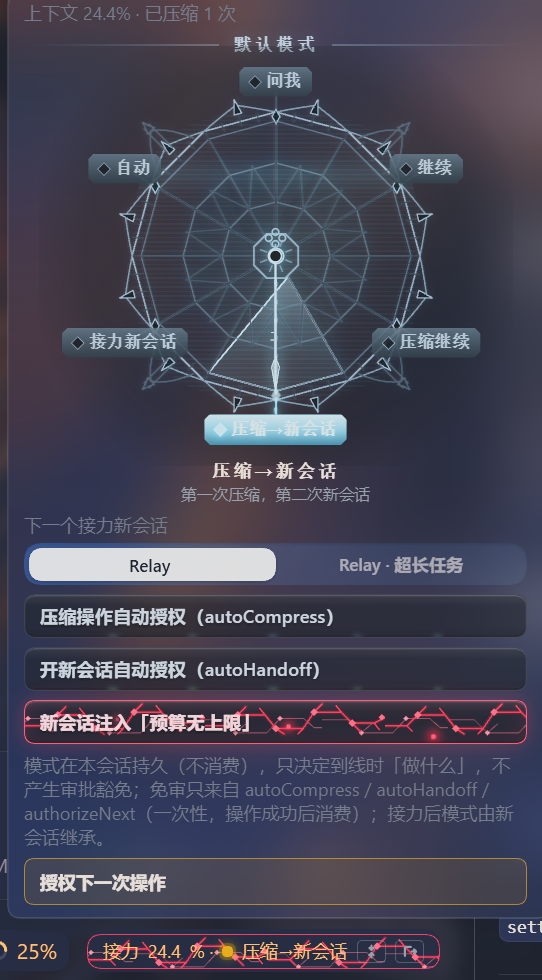

# dsh-context-relay

> Long tasks without drift: keep the context sharp, ask only what must be asked, and stay on course.

[中文](README.md) · [npm](https://www.npmjs.com/package/dsh-context-relay) · [Changelog](CHANGELOG.md) · MIT

**Context-relay plugin for DSH (DeepSeek Harness)**: adds two optional session modes — **Relay** and **Relay · very long tasks**. It does not swap the model or delete history; it changes how long sessions are organised: when to compact, when to start a fresh session, how to hand over, and what should be decided by you.

## The problems it solves

In one line:

1. The session context stays inside its efficient range, so long tasks do not drift apart;
2. Human interaction gets more efficient — the agent knows which questions should come to you;
3. Long and complex tasks keep their bearings;
4. Paired with the official agent team, a two-layer setup pushes long-task capability one step further.

### 1. Keep the session context inside its efficient range

The longer a conversation runs, the more an agent forgets, repeats and over-builds. The plugin sets watermarks for the session:

- Before a line is reached, the agent first writes down what a successor needs to know: goal, settled decisions, evidence, next step;
- Then it compacts the old conversation and puts that page back in, so the work continues without a break;
- At a harder line, the work moves to a brand-new session and the old one stays as an audit record;
- Compaction happens at phase boundaries, never mid-work; extra instructions and skills that get tucked away come with a reminder to re-read them when needed.

The result: a long task no longer depends on saying everything at once — it keeps moving inside a bounded memory.

### 2. Better human interaction: the agent knows which questions are yours to decide

The test is simple: would it change the outcome, the boundaries or the cost? If yes, ask the human; if no, find out first.

- Facts the agent can check itself get checked; only real decisions come to you, and chores do not interrupt you;
- Questions lead with the conclusion and impact, then options (recommended + default + consequence), then wait for one word from you;
- Irreversible, external, paid, credential or delete actions stop first with a plain-language note of what, why and how to roll back, and wait for an explicit yes;
- The same question is not asked twice; answers you give are remembered and carried into the handover;
- When a team already exists, the Lead asks you before opening a separate subagent, instead of going around the team.

### 3. Long and complex tasks stay on track

- Work moves through five phases: understand → decide → build → verify → deliver;
- Each next phase has entry conditions and every phase has completion criteria, so changing the goal mid-way is harder;
- Hitting a context line is only the gate for whether to switch phase; it never interrupts current work;
- Before delivery, a reviewer with a brand-new context independently checks requirement versus implementation, so the agent cannot simply vouch for itself.

### 4. With the official agent team: a two-layer setup, one step further

- In the very-long-task mode the Lead only splits, dispatches and verifies work while teammates build, spreading context pressure across two layers;
- A teammate whose context is dirty can be wiped in place (a true reset) or replaced under a new identity, while the work record is kept;
- When the Lead itself crosses the line, it hands over to a new session: running teammates and background jobs of the old session tree are interrupted, and the new session rebuilds the team and its work memory from the handover and progress documents (it does not take over the old team in place);
- Both layers stay in their efficient range for a long time, raising the ceiling of long tasks.

## Which mode to pick

| Mode | Good for | What it does |
|---|---|---|
| **Relay** | Most long tasks | The Lead does the work; at the line it compacts or starts a fresh session as you chose |
| **Relay · very long tasks** | Especially long, complex, split-friendly work | The Lead dispatches instead of editing code; teammates can be wiped or replaced, so long tasks last longer |

Both modes stay human-gated: no autonomous loop, no automatic approval on your behalf.

## Install

Requires DSH `>=0.2.1-rc.2` and Node.js `>=20`.

### Option A (recommended): DSH Web UI sidebar Plugins

Everything stays in the Web UI — no command line needed:

1. Open the DSH Web UI and click **Plugins** in the left sidebar.
2. Click **Add plugin** in the top-right. (The arrow next to it opens the Choose how to add a plugin menu; **Install third-party plugin** leads to the same dialog.)
3. In the install dialog, fill **Package name** with `dsh-context-relay` (append `@<version>` to pin one). The dialog also accepts Git URLs, tarballs and absolute local paths.
4. Leave **Install source** at its default: on first use it probes the official npm registry and the mainland-China mirror and uses whichever responds first. You can also pick the official npm registry / mainland-China mirror / a custom http(s) URL manually.
5. Click **Install**. The Host first resolves the package and shows its name, one-line description and version; pnpm commands and output stay folded under **View install details**.
6. When installation completes, click **Enable now**. If you closed the dialog, open the `dsh-context-relay` bundle from **Installed plugins** on the Plugins page and switch it on.
7. Follow the prompt to **restart/reload the profile** (profiles with HMR rebuild automatically; otherwise restart `dsh web`), then **refresh the page**.
8. Create a new session: the mode picker should now show **Relay** and **Relay · very long tasks**; after selecting either, a status bar should appear above the composer. Both together mean the install succeeded.
9. Optional: the `dsh-context-relay` config card on the Plugins page sets the watermark basis and panel defaults.

**Troubleshooting**

- No modes after install → make sure the bundle is enabled, the profile was reloaded and the page was refreshed; **a successful install does not by itself activate the module**.
- No status bar → it only appears in relay sessions; sessions created before the reload keep the old way of running — create a new session.
- Updating → uninstall and reinstall to upgrade (this plugin is not an official on-demand bundle, so there is no built-in Update action).

### Option B: command line

```console
dsh plugin --profile web add dsh-context-relay
```

Git and local-directory installs also work:

```console
dsh plugin --profile web add github:rezon-aki/dsh-context-relay
dsh plugin --profile web add /path/to/dsh-plugins/dsh-context-relay
```

After installing, restart/reload the profile, refresh the page and create a new relay session.

## What you get

- Two extra options in the mode picker: **Relay** and **Relay · very long tasks**.
- A **status bar** above the composer (relay sessions only): how much context is used, whether a line was reached, which mode is active; click it to open the panel.
- In the panel you can:
  - choose what happens at the line — continue / compact and continue / hand off to a new session / compact then new session (classic mode) / let the model decide; the choice persists for the session and the next handoff session inherits it;
  - give auto-authorisations for compact, hand off, or just the next operation (no approval prompt while enabled);
  - turn on budget unlimited: the agent receives the line your token budget is unlimited, so it dares to spend (prompt text only, not a kernel quota);
  - see what the model suggests (advice only, never executed automatically).
- At a line you get a status notice (not a user message): it reports state and reminds to finish the current phase first, without interrupting.
- At compaction or identity renewal, still-resident old sessions are released best-effort (the kernel usually auto-releases; this is a fallback, with no promise of memory savings).
- The very-long-task mode also ships teammate management: team status, checkpoints, in-place wipe, renewal, and cross-session rebuild.

### Screenshots

The relay panel: default-mode dial, auto-authorisations, next-session mode, and the authorise-next-operation button (real UI).



## Day to day

1. Pick **Relay** (most cases) or **Relay · very long tasks** when creating a session, then make requests as usual.
2. The agent advances phase by phase: compacts when due, hands off when due, asks when it should.
3. At a line it follows the mode you chose in the panel; with no choice (ask me), it asks you first.
4. For manual control just say so, e.g. compact now, hand off to a new session, or ask me this time.
5. If you ignore a line notice, nothing bad happens — keep giving instructions; it will not compact or hand off on its own.

## Configuration

Optional host plugin config (advanced):

| Key | Default | Meaning |
|---|---|---|
| `threshold` / `settings.threshold` | 35 | Watermark basis (%): a warning 5 points earlier, the basis line suggests handling, 10 points above is the hard line. |
| `settings` | six-field defaults | Initial sidebar defaults; values you save in the UI win. |
| `thresholds` | 0.35 / 0.40 / 0.50 | Legacy thresholds, used only when no UI settings exist. |
| `panelPath` / `settingsPath` | `~/.dsh/data/dsh-context-relay/…` | Overrides for the panel/settings file paths. |
| `injectBrief` | `true` | Whether the handover page is put back into the conversation after compaction. |
| `handoffApproval` | `'required'` | Compaction/handoff must pass the official approval; deployments without an approval UI may set `'off'` (risk accepted by the deployment). |
| `inheritOnHandoff` | `true` | The next session inherits the old model route and permission profile; `false` returns to deployment defaults. |
| `releaseOnCompress` | `true` | After compaction, best-effort release of the Lead own still-resident finished child sessions and retired teammate identities (the kernel usually auto-releases at natural settlement, so usually nothing is left). |
| `releaseRetiredGeneration` | `true` | After a teammate renewal, best-effort release of the old identity still-resident session. |
| `teamFirstSubagents` | `'ask'` | With a team, the Lead needs your approval to open a separate subagent; `'off'` keeps only the protocol text. Fails open when the deployment has no approval service; inactive when `handoffApproval='off'` because the whole approval gate is not installed. |
| `presetId` / `longPresetId` | `relay` / `relay-long` | Internal ids of the two modes. |

Sidebar settings (human-editable, hot-reloaded): watermark basis + default mode / auto decide / auto compact / auto handoff / budget unlimited.

Panel state (per session): persistent mode (not consumed; inherited by the next handoff session), auto-authorisations, auto-decision record, handoff target mode, budget unlimited, model advice.

Data files: `~/.dsh/data/dsh-context-relay/settings.json` and `panel.json`; conversation content stays stored by DSH itself.

## Technical reference: agent tools and HTTP API

| Tool | Purpose |
|---|---|
| `relay_status` | Read current context usage, line state, phase, budget headroom and advice. |
| `relay_phase` | Declare or switch phase; validates entry conditions and the self-check; delivery requires an independent review and a report. |
| `relay_organize` | Write the handover page (with automatic documentation check and key-file index) → official compaction → inject the page back (with a re-read-when-needed reminder). At most once per session by default; when the human sets the panel mode to compact and continue, a second compaction runs as the human chose (approval still applies); without a panel mode the second one needs an explicit human request (`force`). |
| `relay_handoff` | Produce a handover of at most 8KB (including the rolling progress file), create a new relay session and clean up the old session tree. |
| `relay_recommend` | Lead only: write the model advice into the panel (cleared on phase switch, compaction, handoff or human choice). |
| `doc_lint` | Four-part documentation check (quota / banned wording / index / git), output at most 2KB. |

**Relay · very long tasks** adds team tools: `relay_team_status`, `relay_renew`, `relay_rehydrate` (Lead) and `relay_checkpoint`, `relay_freshen` (teammates).

HTTP (available only behind the local GUI authentication): `GET/PUT /context-relay/settings`, `GET/PUT /context-relay/panel`, `GET /context-relay/api` (handoff publication box).

## Safety boundaries and costs

- **Approval**: compaction and handoff need your go by default; exemptions come only from the panel auto-authorisations (compact / handoff / just the next operation). The panel mode itself only decides what to do and never grants an exemption.
- **Team first**: with a team, the Lead asks you before opening a separate subagent; turn it off, or with no approval service, it degrades to protocol text.
- **A handoff creates a new session and consumes quota**: it interrupts running teammates and background jobs of the old session tree and migrates scheduled jobs; the old session is marked as handed off for audit.
- **Compaction is lossy**: old conversation detail survives only in that handover page; put important conclusions into documents.
- **No autonomous loop**: relay stays human-gated; use the official Ralph / workflow / subagent for repetitive bulk work (with a team, opening a subagent needs approval first).
- **Irreversible actions**: external, paid, credential or delete actions are reported first and need an explicit go; the plugin never auto-approves them.

## Known limitations

- Sessions created before a plugin reload keep the old way of running; new behaviour applies to relay sessions created after the reload.
- Verified on the DSH Web environment only; headless and other deployments are untested.
- The real benefit of compaction/handoff depends on model and task length; watermarks are not universally optimal.
- Visual details have no automated regression coverage — inspect after installing.
- Compaction fidelity and benefit have no strict A/B; neither do the watermark inflection points.
- A session compacts once by default to avoid summary drift; when the human sets the panel mode to compact and continue, a second compaction runs as the human chose (approval still applies); without a panel mode it needs an explicit human request (`force`).
- If writing the panel state fails it lives in memory only (lost on restart); settings writes are persist-first.
- UI text is Chinese-only; the Chinese docs are the source of truth.
- Resource reclamation is a fallback: the kernel usually auto-releases at natural settlement, so a compaction usually has nothing left (no memory-saving promise); only rare cases such as a still-resident old identity at renewal actually free anything.
- The team-first hard gate matches the exact tool names `subagent` / `subagent_fork`; other custom delegation tools are out of scope.

## Development

```console
npm test        # node --test test/*.test.mjs
npm run check   # syntax checks for every entry point
```

No build step: host and client are hand-written ESM. Hot-inject for development; ship as a bundle via `cordis.patch.yml`.

`lib/policy.js` (pure policy functions), `lib/panel-store.js` (panel state), `lib/agent.js` + `lib/agent/*` (preset plane), `lib/index.js` (host plane / HTTP), `lib/client.js` (Web UI bundle), `lib/preset-base.js` (PTC preset assets), `skills/` (bundled skills).

See [CHANGELOG.md](CHANGELOG.md).

## License

MIT
