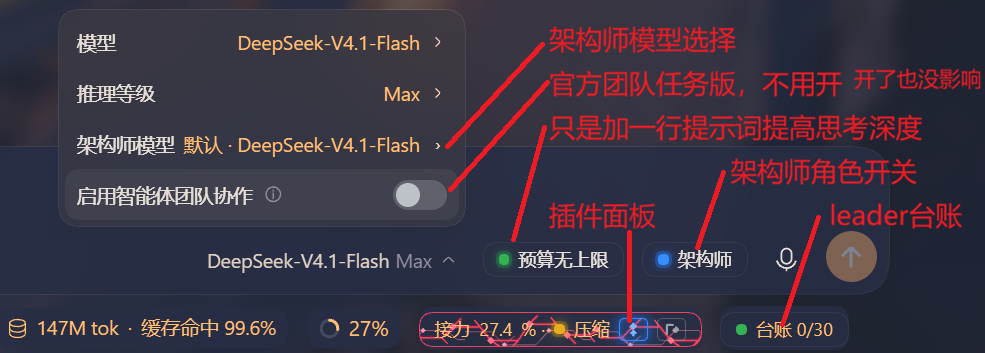
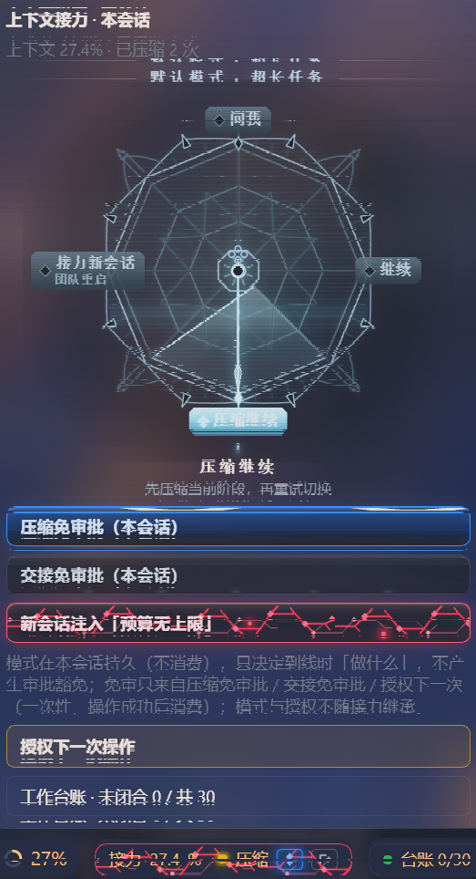
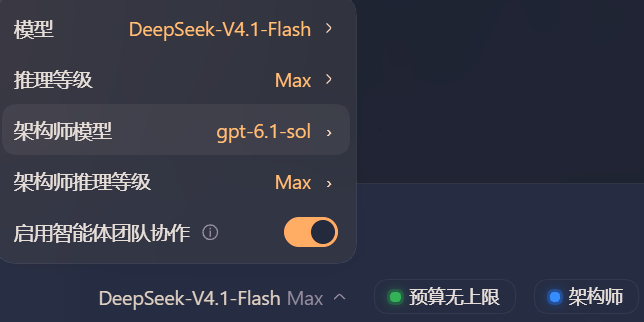

# dsh-context-relay

[](https://github.com/rezon-aki/dsh-context-relay)

> An agent suite with a two-layer architecture built on official subagents: a Leader dedicated to interfacing with you and managing the team; document governance and chained memory; only the minimum necessary context, with documents fetched on demand; the whole team working efficiently at low context; implementation drift and corner-cutting corrected and verified; human interaction tuned; and only the minimum necessary verification — heavy testing only with your consent; plus a dedicated architect with independently configurable model and reasoning effort, ultra-low-context, contamination-free and burden-free, who finalizes the engineering implementation; and the "your token budget is unlimited" switch, whose one-line hint strengthens dsh41f's depth of thought.

[中文](README.md) · [npm](https://www.npmjs.com/package/dsh-context-relay) · [Changelog](CHANGELOG.md) · [Migration](docs/design/MIGRATION.md) · MIT

**A long-task plugin for DSH (DeepSeek Harness).** After install there is exactly one mode: **Relay mode · very long tasks**. It keeps an agent clear-headed through very long sessions: it tidies its own context as it fills up, tells you when a line is reached, and carries what matters into a fresh session when it's time to move. It can also hand work to a small standing team: a Lead that splits and checks the work, teammates that do it.

It doesn't swap your model, delete your conversation, or make your decisions for you.

## Quick intro



The menu below the composer: model, reasoning effort, architect model, and enabling official agent team collaboration.

## The problems it solves

1. **The context stays where it works efficiently.** Long tasks don't drift, and they don't get more expensive the longer they run.
2. **Only the questions that are yours reach you.** What the agent can find out itself, it finds out; what genuinely needs your call, it asks clearly, once.
3. **Work moves ahead in phases.** Every phase has a clear start and a clear finish, so it's harder to wander off part-way through.
4. **A two-layer setup with the official agent team.** Execution pressure goes to teammates, which raises what long tasks can take on.

### 1. Keeping the context in its efficient range

The longer a conversation runs, the more an agent forgets things, repeats itself and over-builds. The plugin sets a few watermarks for the session (values are in the [configuration](#configuration-optional-advanced); you can change them in the panel):

- **Lowest watermark:** one reminder — a reminder only, not an interruption.
- **At the basis line:** it suggests dealing with the context, and compaction is an option.
- **One step higher:** it suggests handing off to a new session.

What happens at each one is up to you (or the panel settings). The plugin never compacts or starts a new session on its own.

### 2. Asking only what has to be asked

The test is simple: would it change the outcome, the boundaries or the cost? If yes, ask. If no, find out first.

How to ask and how to report is in [Reports and questions](#reports-and-questions).

### 3. Phase by phase, so the work doesn't wander

- Work moves through five steps: understand → decide → build → verify → deliver, and each step has its own completion criteria.
- Reaching a context line is only a gate on whether to change phase; it never interrupts what's in your hands right now.
- Before delivery, the design comes to you first; then a reviewer with a completely fresh context independently checks that what was built is what you asked for.

### 4. A two-layer team

- In the only mode, the Lead splits work, dispatches it and checks it; the actual building goes to teammates, so context pressure is shared across two layers.
- When a teammate's context is dirty, it can be wiped in place and started over, or replaced under a new identity, without losing the work record.
- When the Lead itself reaches a line, it hands over to a new session: teammates and background jobs still running in the old session are interrupted first. The handoff guarantees **chain memory can be retrieved** (`chain.ndjson` + progress + handover pointers, read back by `session_event_read` with a seq); it does **not** guarantee the team comes back, and it neither rebuilds nor replays. `adopt` only sees the current live tree (a historical name already in the roster returns already-known even if live); `allowSpawn=true` only enables new members via `renew`/`dispatch`, not handoff recovery.
- The Lead doesn't idle after dispatching: teammates' reports arrive on their own, and it waits only when genuinely blocked.

## Before you install

- **There is only one mode:** Relay mode · very long tasks (internal id `relay-long`). It's for work that is very long, very complex and can be split up; short tasks don't need it.
- **A human stays in the loop.** No automatic loop, and no automatic approval on your behalf. Compaction and handoff need your go by default; the only exemption is an auto-authorization you turn on in the panel.
- **Compaction is lossy.** The detail of the old conversation survives only in that one handover page; put important conclusions into documents.
- **Handoff opens a new session.** It interrupts teammates and background jobs running in the old session and migrates scheduled jobs; the old session stays as an audit record.
- **Version requirements:** DSH `>=0.2.2-rc.2` (this kernel generation only), Node.js `>=20`. It has only been verified in the DSH Web environment; headless is untested.
- **v0.10.0 is a breaking release.** The old classic `relay` alias, the dual-mode configuration and the old config keys are all gone, and the panel authorization contract moves to version 3 (old authorizations expire once after the upgrade; mode and architect settings are kept). Read the [migration guide](docs/design/MIGRATION.md) before upgrading.
- **v0.11.0 changes defaults:** capacity 55% (independently configured), spawn off, squad-only display by default, explicit reopen for post-delivery repair, and host-compaction fallback. See [CHANGELOG.md](CHANGELOG.md) and the migration guide.
- **v0.12.0 refines behaviour (no migration):** gates by risk tier (T0 doc-only changes may skip the design gate and independent review, but only with actual diff evidence; T2 keeps every gate), T2 design-gate echo (your own words + not-doing list), plain-language output (three questions since v0.13), a document index with A/B/C layers and injection metrics, role-trimmed tools/skills, and a constraints/contracts/relations semantic layer. See [CHANGELOG.md](CHANGELOG.md).
- **v0.15.0 consolidates interaction and the contract (no migration):** decide whether it is worth interrupting, pick the lightest form (one line / decision card / formal report), and use no fixed template; formal reports are only checked for non-empty; tool returns are internal facts only (state / what happened / where it is stuck / next / evidence / risk), never a user segment; the question tool is only for simple questions, complex ones are asked as messages and wait for a reply, and a timed-out `pending` only means unanswered; a handoff session keeps the current model selection. See [CHANGELOG.md](CHANGELOG.md).
- **v0.15.1 is a maintenance patch:** fixes a test-environment dependency in the automated publish flow; behaviour is identical to v0.15.0, with no data migration. See [CHANGELOG.md](CHANGELOG.md).

## Install

### Option A (recommended): a few clicks in the Web UI

1. Open the DSH Web UI and click **Plugins** in the left sidebar.
2. Click **Add plugin** in the top right, then put `dsh-context-relay` in the **Package name** field (write `dsh-context-relay@<version>` to pin a version; Git URLs, tarballs and local paths are accepted too).
3. Leave **Install source** at its default — it automatically picks whichever of the official npm registry and the mainland-China mirror responds first — or set it by hand.
4. Click **Install**, and **Enable now** when it finishes. If you closed the dialog, open `dsh-context-relay` under **Installed plugins** and switch it on there.
5. Follow the page's prompt to **restart/reload the profile** (profiles with hot reload rebuild themselves), then **refresh the page**.
6. Create a session and pick **Relay mode · very long tasks** in the mode picker (the UI item is labelled 接力模式（Relay）· 超长任务). A status bar above the composer means it's installed. You can also start with a normal session and switch over — before the first turn or mid-session.

### Option B: command line

```console
dsh plugin --profile web add dsh-context-relay
```

Git and local-directory installs work too:

```console
dsh plugin --profile web add github:rezon-aki/dsh-context-relay
dsh plugin --profile web add /path/to/dsh-plugins/dsh-context-relay
```

Either way you still need to reload the profile, refresh the page, and then create or switch to a relay session.

### Installed but nothing shows up?

- **No "Relay mode":** make sure the bundle is enabled, the profile has been reloaded and the page refreshed. A successful install does not by itself activate the module.
- **No status bar:** the status bar only appears in relay sessions; switch to Relay in the mode picker and it takes effect immediately, with no need to rebuild the session.
- **An old session behaves oddly after an upgrade/reload:** switch its mode once, or create a new session.
- **To upgrade the plugin:** uninstall it from the Plugins page and install it again (there's no built-in Update button).

## What you get after install

- The mode picker has exactly one production mode: **Relay mode · very long tasks**.
- A **status bar** above the composer (relay sessions only): how much context is used, whether a line has been reached, and which mode is active. Click it to open the panel.
- Once work items have been recorded, a **ledger chip** appears next to it (`ledger 3/8` = open items / total; an amber dot means in progress, a red dot blocked). Click it for the full list.
- When the context reaches a line you get a **status notice** (not a user message): warn says "deal with it now" (compact / reset-reuse / hand off); organize/relay are fallback warnings; the capacity line (see the configuration table) is the last resort. It never acts on its own and doesn't interrupt you.

### What you can change in the panel

- **What happens at a line:** ask me / keep going / compact and continue / hand off to a new session. The default is "ask me"; a new session that has never been changed in the panel starts from "compact and continue".
- **Auto-authorization:** turn it on for compaction, for handoff, or for just the next operation. While it's on you aren't asked each time, and you can switch it off whenever you like.
- **Unlimited budget** (the small pill to the right of the model picker in the composer): when it's on, the agent receives the line "your token budget is unlimited", so it dares to spend tokens — this only changes the prompt, not the real kernel quota. The Lead's setting is inherited by the teammates, architects and workers it creates; a teammate that's already running picks it up at its next freshen, or when the architect continues.
- **Model advice:** a suggestion only; it is never executed automatically.

### Day to day

1. Create a session and pick Relay (or switch to it afterwards), then ask for what you want as usual.
2. The agent moves through phases on its own: it tidies up when it's due, reminds you when it's due, asks you when it's due.
3. When a line notice appears, handle it the way the panel says; if nothing is set (ask me), it asks you first.
4. To take manual control, just say so — "compact now", "hand this off to a new session", "ask me this time".
5. Ignoring a notice is fine: keep giving instructions. The plugin won't compact or start a new session on its own.

### Screenshot

The relay panel: the dial (ask me / keep going / compact and continue / hand off), per-session exemption from approval for compaction and for handoff, authorization for the next operation, "unlimited budget" injected into the new session, and the work ledger:



## What it does for you, and when it comes to ask

### Reaching a line, and what happens next

- **Four line tiers:** proactive management at a fresh start; warn means "deal with it now" (compact / reset-reuse / hand off); organize/relay are fallback warnings; the capacity line (separately configured; see the configuration table) is the last resort. A status notice doesn't interrupt you and is never executed automatically.
- **You pick "compact and continue", or say "compact":** the agent first writes what a successor needs to know onto one page (the goal, what has been settled, the evidence, the next step), compacts the old conversation, puts that page back in, and keeps going.
- **You pick "hand off to a new session", or the context reaches the hard line:** it writes a handover sheet, opens a new session and sends it the summary; the old session stays. Teammates and background jobs in the old session are interrupted, and scheduled jobs move to the new one.
- A session compacts once by default (so the summary doesn't drift a little further with every pass); choosing "compact and continue" in the panel allows a second one, still subject to approval.
- **Capacity line** (`settings.capacityThreshold`, independently configured; default in the configuration table): once reached, finish the current action, stop starting new work or dispatching, write the brief/progress/ledger first, then compact or hand off according to the mode/authorization; it never executes automatically.

### Phases, and the two points where you sign off

Every phase has a clear start and a clear finish. Two things have to line up before delivery:

1. **Design gate (before T2 work starts):** the design — how it will be done, what it will touch, how it will be checked, what the risks are — comes to you for confirmation. Work starts only after you confirm it. For T1 the design lives in the phase goal (≤1 page); T0 writes no separate design doc.
2. **Independent review before delivery:** a reviewer with a completely fresh context checks requirement against implementation for drift, scope shrinkage, corner-cutting and gaps — so the implementer can't mark its own homework. The review runs alongside the rest of acceptance, not as one more serial gate.

Acceptance stays minimal by default: run the target tests, do one independent diff review, and (if needed) one syntax check. Heavy verification — a full regression suite, real-device runs, large samples, several review rounds — isn't done by default and needs your explicit approval.

- **Gates follow risk:** changes are graded T0 (docs/trivial), T1 (local code) or T2 (public surface / data format / permissions / irreversible / large change). T0 may skip the design gate and the independent review but needs actual diff evidence (`paths` + `lines`, docs-only and ≤20 lines; a reason alone downgrades to T1); T1 keeps one diff review (reusing a conclusion for the same diff requires `diff_hash`; reopen/new task clears it); T2 keeps every gate. User-visible behaviour, tool schema/return contracts and public surfaces such as `lib/index.js` are auto-upgraded to T2. You can set the tier explicitly with `relay_phase`'s `risk`, or let it be classified automatically (unknown signals fall back to T2).

### Reports and questions

- It talks to you in plain language: no command output, logs or long diffs, no piles of internal fields and jargon; a term is explained the first time it appears.
- A report before delivery covers four things: what changed (what you can observe), impact (result, cost, unverified risk), what you need to do (with a recommendation and default), and boundaries (what was not done or not verified); keep it under 600 characters by default and give evidence pointers.
- **Tool returns are not user speech:** status, handoff, collect and failure results are internal facts for the Lead (reason / what already happened / whether it can be retried / next / evidence / risk); the Lead turns them into a plain report or stays silent. No user segment is produced, and nothing is meant to be pasted verbatim.
- **When your call is needed, give a decision card on the spot** (the seven fields are in the protocol's "Interacting with the user" section); documents are evidence only, never the whole answer.
- Anything the agent can check for itself, it checks first; only the questions that genuinely need your call come to you, all at once (recommendation + default + cost of not deciding); answered questions are not asked again, and your answers carry into the next relay.
- Irreversible, external, paid, credential or delete actions are announced first — what will be done, why, and how to undo it — and only happen after an explicit yes.

## The team: Lead, teammates and the architect

- **The squad is fixed, capped at 8 by default (including the architect)**; `squadMax` can be raised. **Spawn is allowed by default** (still capped by squadMax; existing members are reused first); when no one is eligible, reset-reuse an existing teammate or adopt a historical member, then `dispatch`/`renew` for a new member (`allowSpawn:false` disables it, or use a manual official subagent). A phase-boundary handoff archives the old session but **does not rebuild the squad**.
- **The Lead only coordinates:** it splits work, dispatches it and checks it, while the actual building goes to teammates. Every dispatch comes as a standard brief: the goal, the must-read material, which files it may change, how the work will be checked, and where the report goes.
- **Tools and skills are trimmed by role:** the human-loop skill is registered only for the relay Lead (`context-relay`/`doc-governance` stay global); `doc_lint` and questions meant for a human (`ask_user_question`) go to the Lead only; teammates keep status/phase/doc plus checkpoint/freshen, workers keep only `relay_doc` (bounded reads of briefs/handoffs); the architect and workers drop `relay_status` and `relay_phase`. Tool names and parameters are unchanged.
- **Replacing a teammate means true reset-reuse first:** have it checkpoint, then `relay_freshen({reset:true,brief})` (same member, zero quota); only an identity/role change (with spawn enabled) uses `relay_renew`. Historical members are hidden and not dispatchable by default; use `relay_team_status({manage:{action:'adopt',...}})` to include them, or `manage:{action:'retire',scope:'legacy',...}` to clean up (catalog names are never deleted; use handoff to truly clear the team).
- **It doesn't hover over teammates:** reports arrive automatically, so the Lead doesn't spin in a polling loop — which saves tokens.

### The dedicated architect

The most expensive mistake in a long task is starting to write before the route is clear. This mode gives the team a fixed **architect teammate** (always named `architect`, created once and reused):

- **The Lead does two things:** align requirements with you (boundaries, acceptance, trade-offs) and read the project docs to understand the current state.
- **The architect turns requirements into an engineering route:** every task starts from a low context, reads only what it must, and produces an engineering implementation document (requirement alignment, technical route, module interfaces, risks and trade-offs, open decisions, implementation steps and acceptance).
- **The decisions that are yours:** the architect writes each into the document's "open decisions" with question / options / impact / benefits and risks / recommendation / default / consequence of not choosing, and reports them to the Lead. The Lead must turn them into a **decision card and ask you directly** (documents are evidence only), then pass the answer back. The architect never asks you directly, and never decides for you.
- **The switch:** the small "architect" pill next to "unlimited budget" in the composer (relay sessions only, on by default) controls per session whether route design is handed to the architect.
- **The model:** open the composer's model picker; under **Model / effort** there are two more rows, **Architect model / Architect effort**. They follow the model you picked by default and can be set separately (an explicit choice has to be inside the official subagent allowlist).



Set the architect model / reasoning effort in the composer's model menu; follows your model by default, can be set separately.

## The work ledger: its own phase-level to-do list

Long tasks drift as they run: the agent forgets what it set out to do and how far it got. The ledger turns "what has to be finished in this phase" into a list:

- When a new phase opens, lay out its points (1–8), and add more whenever needed.
- While working, the current point and the next step are kept in view; if files were changed but the list wasn't updated, it reminds once.
- At a phase change, unfinished points are closed out or explicitly carried into the next phase.
- The list travels with compaction and handoff into the new session, so nothing falls through the gap.
- The chip in the panel shows every item (read-only; editing is done by the agent).
- **Completion confirmation gate:** before a point moves from not-done to done, the Lead must confirm all three — no drift, nothing missing, no regression — after reviewing the diff, requirements and tests. Missing or incomplete confirmation is refused with `done-gate` (whole-table write, zero side effects); collecting a done receipt via `relay_collect` uses the same rule and returns `confirmation-required` (the item stays not-done, the ledger is unchanged).
- The ledger is optional: with no ledger file, everything behaves exactly as before. The default cap is 30 items; past that, finished items are archived first.

## Configuration (optional, advanced)

Host plugin configuration:

<!-- config-table:begin (generated by scripts/gen-config-table.mjs; do not edit) -->
| Key | Default | What it does |
|---|---|---|
| `threshold` / `settings.threshold` | 35 | Watermark basis (%): a reminder fires 5 points earlier, at the basis line it suggests dealing with the context, and 10 points above that is the hard line. Since v0.10.0 this is the only source for the threshold. |
| `settings` | six-field defaults | Initial defaults for the panel; anything you've saved in the UI wins. |
| `settings.capacityThreshold` | `55` | Capacity line (%, 20–95, independent of the band threshold; setting 85 is close to the old behaviour). |
| `allowSpawn` | `true` | Whether dispatch/renew may create members (allowed by default, still capped by squadMax); when false, replace via reset-reuse/adopt/handoff only. |
| `squadMax` | `8` | Squad cap (including the architect; can be raised; 32 is the defensive ceiling). |
| `contextCheck` | `'on'` | Proactive self-check at a new phase/task; `'off'` silences it. |
| `reopenGate` | `'strict'` | ship→build/verify repair gate: `strict` / `warn` / `off` (off = old v0.10 behaviour). |
| `compactionFallback` | `'on'` | Host-compaction attribution fallback: write a minimal recovery snapshot + one notice on host attribution; `off` logs only. |
| `receiptVerify` | `'warn'` | Receipt/review evidence check: `warn` (default; missing commit/verification is flagged unverified), `strict` (missing → refused), `off` (no check). |
| `strictToolArgs` | `false` | Arguments outside a tool's schema: `false` (default) only records JSONL + warns, `true` returns invalid-args. |
| `panelPath` / `settingsPath` | `~/.dsh/data/dsh-context-relay/…` | Where the panel and settings files are kept. |
| `architect` | `true` | Default for the architect switch (the composer's architect pill overrides it per session). |
| `workItems` | `true` | Enables the work ledger; setting it to `false` goes back completely to the old behaviour (it conflicts with the dispatch-work-first protocol, and a warning is shown at load). |
| `workItemsGate` | `'strict'` | How firmly the ledger is checked at delivery: `strict` refuses when it isn't in order / `warn` only reports / `off`. Compaction and handoff always write the ledger into their material and are not affected by this key. |
| `workItemsPhaseGate` | `'warn'` | The nudge when a phase changes: `warn` reports and lets the switch through / `strict` refuses to switch / `off`. Single-threaded work gets through by declaring an empty list of points. |
| `delegationGate` | `'warn'` | The build→verify dispatch gate: `warn` only reminds / `strict` refuses on a hit / `off`. It checks whether the Lead is executing too much itself, and whether a point the Lead should have handled was handed to a worker. |
| `workItemsPath` | per session | Where the ledger file lives; set it explicitly and every session shares one file. |
| `workItemsMax` | `30` | Ledger item cap (1–100). |
| `injectBrief` | `true` | Whether the handover page is put back into the conversation after a successful compaction. |
| `handoffApproval` | `'required'` | Compaction and handoff go through the official approval by default; a deployment with no approval UI can set `'off'` (at its own risk). |
| `inheritOnHandoff` | `true` | The new session inherits the old session's model and permissions; `false` falls back to deployment defaults. |
| `longPresetId` | `'relay-long'` | The id of the only mode (rarely worth changing). |
| `docs.select` | `true` | Document-index v2 selection (in-service/decision single-listing + directory groups). Set to `false` / `'legacy'` / `'off'` to truly roll back to the v0.11 renderer: all L1/L2 single-listed, largest directory folded, history tail, no A/B/C levels. |
| `docs.layout` | `true` | Automatic width/group layering (W/G) of the index. Set to `false` / `'flat'` / `'off'` to disable W/G (no width- or group-triggered downgrade). The default byte budget is 0 = unlimited; levels only change via explicit docs.width / docs.maxGroups. |
| `docs.metrics` | `true` | Whether index/read/search write `.scratch/context-relay/metrics/<session>.ndjson`, and whether `relay_status.docs` summarises them. Set to `false` / `'off'` to write no events and omit the docs block from status. |
| `docs.width` | `0` | Display-column budget for single-listed entries (CJK/emoji count 2): the default `0` means unlimited (no width-driven folding); a positive integer triggers A→B, and if pinned lines still exceed it in B, C. Ignored for layering when `docs.layout` is off. |
| `docs.maxGroups` | unset (G off) | Explicit group cap (integer ≥0): when the number of directory groups exceeds it, C (setting 0 forces C when groups exist). G only runs when this key is set. |
<!-- config-table:end -->

Sidebar settings (human-editable, applied live): watermark basis / default mode / default auto-compact authorization / default new-session authorization. "Unlimited budget" and "architect" are not in the sidebar: they are per-session switches in the composer, defaulting from `settings.unlimitedBudget` (default true) and the `architect` config (default true).

Data files: `~/.dsh/data/dsh-context-relay/settings.json` and `panel.json`; conversation content is still stored by DSH itself.

## FAQ

**Q: Why is there no "Relay mode" after install?** See "Installed but nothing shows up?" above — usually the bundle isn't enabled, the profile wasn't reloaded, or the page wasn't refreshed.

**Q: The context reached the line — why didn't it compact or hand off by itself?** It needs your go by default; it only acts on its own once you turn on auto-authorization in the panel. The mode only decides what to do; it doesn't grant permission.

**Q: Where did my auto-authorizations go after upgrading?** v0.10.0 moved the panel authorization contract to version 3, so old authorizations expired once; turn them on again in the panel. Mode and architect settings are kept.

**Q: With "unlimited budget" turned off, will teammates still get that line?** Teammates, architects and workers created afterwards inherit the "off"; ones already running pick it up at their next freshen, or when the architect continues.

**Q: A teammate's context is dirty, or it's stuck — what do I do?** Have the Lead get it to checkpoint, then `relay_freshen({reset:true,brief})` to wipe and reuse it in place (the work record is kept, same member, zero quota); only an identity/role change (with spawn enabled) uses `relay_renew`. Historical members must be adopted first.

**Q: Will it delete my conversations?** No. Compaction is only compaction: old detail stops appearing in the current context, but DSH still stores the history, and both the old and the new session of a handoff are kept.

**Q: Does uninstalling delete my data?** No. It only unregisters the plugin's capabilities and keeps `panel.json`, `settings.json` and the workspace's `.scratch/context-relay/`; if you want them cleaned up, back them up first and delete them by hand.

**Q: Can I use it headless or in another deployment?** It has only been verified in the DSH Web environment; other deployments are untested.

## Known limits and things to keep in mind

- **Approval and authorization:** compaction and handoff need your go by default; the only exemption comes from auto-authorization in the panel. The mode itself only decides what to do, and never creates an exemption.
- **Only the current squad is shown by default:** legacy (historical) and retired members are hidden and not dispatchable; use `include_legacy`/`include_retired` to see them, adopt to include, or retire to clean up. Catalog names are never deleted; retirement is irreversible.
- **Capacity is not judged when the window is unknown:** with no projection/meter the capacity notice stays silent; the band's absolute-token fallback still applies.
- **reopen count:** with a projection available `relay_status.reopen` uses an in-process cache, so a cold start may show 0 until a no-projection scan or a later reopen corrects it.
- **Kernel version:** only this generation of DSH (0.2.2-rc.2) is supported. If the kernel's shape doesn't match, the plugin falls back and says so (check `relay_status.plane.degradations`); it doesn't fail silently, and it doesn't refuse to open a session.
- **The program channel is a soft limit:** trimming the tool surface only hides the model's `bash`/`pwsh`/`write`/`edit` calls; inside `run_code`, `node:fs` or a child process can still read and write files directly. The plugin doesn't police that channel (a settled trade-off); it relies on the protocol, self-checks and reports, and promises no hard isolation.
- **Handoff has a cost:** it opens a new session and consumes quota, interrupts teammates and background jobs running in the old session, and migrates scheduled jobs; the old session is kept for audit.
- **Compaction is lossy:** old conversation detail survives only in that one page; put important conclusions into documents.
- **No autonomous loop:** a human stays in the loop; for repetitive bulk work use the official Ralph / workflow / subagent.
- **What compaction and handoff buy you depends on the model and the task:** the watermarks aren't optimal for everyone, and no strict A/B comparison has been run.
- **Only Web is verified:** headless and other deployments are untested; visual details have no automated regression coverage, so have a look after installing.
- **A session compacts once by default:** to keep the summary from drifting with every pass; choosing "compact and continue" in the panel allows a second one, still subject to approval.
- **Panel state:** if writing it to disk fails it stays in memory only (and is lost on restart); settings files are persisted.
- **UI text is Chinese only:** the Chinese docs are the source of truth.
- **The work ledger is session-level and Lead-only:** several relay sessions in the same workspace each have their own; teammates and subagents don't read or write the Lead's ledger, and the panel is read-only. The default cap is 30 items; past that, finished items are archived first — nothing is deleted automatically.
- **Resource reclamation is not promised:** the kernel releases a child session when it ends naturally; the plugin keeps only an internal handle for renewal capacity, and never promises that compaction frees memory.
- **The preset is switchable (since v0.10.0):** after a mode switch or a plugin reload, existing sessions are backfilled idempotently, so a new session is no longer required; if `relay_status.plane.installed` is false, check `degradations` to see which capability is missing, or switch the mode once / create a new session.
- **The architect model follows your model choice by default:** an explicit choice has to be inside the session's official subagent allowlist.

## Upgrade and uninstall

**v0.15.0 consolidates interaction and the contract (no data migration):** user-facing interaction is consolidated into decide → pick the lightest form → say only what a decision needs; the three forms are chosen by impact and no fixed template is required; formal reports are only checked for non-empty (over-length and log-dumping warnings remain); tool returns are internal facts only and the user segment/`human`/`user`/`user_visible` are removed; the Lead writes the three questions and decision cards; failures and partial success carry `effects`/`retryable`/`next`; handoff guarantees chain memory only and keeps the current model selection.

**v0.13.0 was the "user-segment material" release (superseded by v0.15.0):** `[给用户]` three-question output by default, default silence, `manage.maintain`, receipt evidence, `review_ref`, parameter warnings, a single-source config table, legacy golden, persisted risk tier and path-first `isDocItem`. Tool count and data formats are unchanged.

**v0.12.0 refines behaviour (no data migration):** risk-tier gates, the T2 design-gate echo, plain-language output (three questions since v0.13), the v2 document index, role trimming and the constraints/relations semantic layer; old T2 `design_gate` calls now need `ask_ref`/`not_doing`. Tool count and data formats are unchanged.

**v0.11.0 changes defaults/behaviour (no data migration):** capacity 85%→55% independently configured, spawn off, squad-only display by default, four-tier line semantics, explicit reopen for post-delivery repair, and host-compaction fallback. Rollback mapping is in the [migration guide](docs/design/MIGRATION.md).

**v0.10.0 is a breaking release** (upgrading straight from 0.8.x): `panel.json`'s `schemaVersion` moves to 3, so authorizations in the old file expire once (auto-compact / auto-handoff / next-operation authorizations need to be turned on again; mode and architect settings are kept); the classic `relay` alias, `routerMode`/`legacyPresetCompat`, `config.thresholds`, cth/autoChoose/autoDecision/handoffPreset and `next_operation` on `relay_phase` are all removed. Open an old classic session and switch it to Relay in the mode picker to backfill it. The full list and the upgrade steps are in the [migration guide](docs/design/MIGRATION.md); per-release notes are in [CHANGELOG.md](CHANGELOG.md).

**Uninstall** unregisters the preset, skills, HTTP routes, tools, projections and background sentinels, but keeps your data (`panel.json`, `settings.json` and the workspace's `.scratch/context-relay/`). If you want it cleaned up, back it up and delete it by hand — the plugin never deletes data on its own.

## Development

```console
npm test        # node --test test/*.test.mjs
npm run check   # syntax check for every entry point
```

There's no build step: the host and the client are hand-written ESM; you can hot-inject while developing, and it ships as a bundle (`cordis.patch.yml`).

Main directories: `lib/policy.js` (the single source for policy), `lib/risk.js` (risk tiers and gate keys), `lib/output.js` (internal-fact rendering and notice wording), `lib/docs-policy.js` + `lib/docs-metrics.js` (v2 document index and injection metrics), `lib/skills.js` (role-based skill registration), `lib/seams.js` (the official kernel extension contracts), `lib/plane/` (role table and idempotent reconcile), `lib/storage.js` (atomic writes and locks), `lib/panel-store.js` (panel state), `lib/agent.js` + `lib/agent/*` (the preset plane and its tools), `lib/agent/notice/` (notice planning and delivery), `lib/index.js` (host plane / HTTP), `lib/client.js` (Web UI), `lib/preset-base.js` (PTC preset assets), `skills/` (bundled skills).

## Advanced reference (for the curious)

Deeper design and implementation notes live in:

- [Architecture](docs/design/ARCHITECTURE.md): layers, the 9 official kernel extension points and how the plugin behaves when one doesn't match, the agent plane, the persistence/policy/notice layering, and the phase and ledger contracts.
- [Design](docs/design/DESIGN.md): positioning, design goals, boundaries and how acceptance is judged.
- [Migration](docs/design/MIGRATION.md): the v0.11.0 default changes and rollback mapping, plus the 0.8.x → v0.10.0 breaking changes.

### Tools and endpoints

15 tools in total: 8 preset-level tools (4 of them Lead-only: `relay_recommend`/`relay_organize`/`relay_handoff`/`relay_work_items`, plus Lead-only `doc_lint`) + 5 agent-scope Lead-only tools (`relay_team_status`/`relay_renew`/`relay_architect`/`relay_dispatch`/`relay_collect`) + 2 shipped with teammates (`relay_checkpoint`/`relay_freshen`; the architect gets only the former). Tools and skills are trimmed by role (`human-loop` is registered only for the Lead; `context-relay`/`doc-governance` stay global):

| Role | Tools | Skills |
|---|---|---|
| Lead (root) | 13 relay tools (including `doc_lint`) + the host's human interface `ask_user_question`; the execution tools `bash`/`pwsh`/`write`/`edit` are hidden | `context-relay`, `doc-governance`, `human-loop` |
| teammate (direct) | `relay_status`/`relay_phase`/`relay_doc` + `relay_checkpoint`/`relay_freshen` | `context-relay`, `doc-governance` |
| architect | `relay_doc` + `relay_checkpoint` | `context-relay`, `doc-governance` |
| worker (plain subagent) | only `relay_doc` | `context-relay`, `doc-governance` |

All three subagent roles drop `doc_lint`, `ask_user_question` and the Lead-only tools (`relay_organize`/`relay_handoff`/`relay_recommend`/`relay_work_items`); the architect and workers also drop `relay_status` and `relay_phase`.

| Tool | What it does |
|---|---|
| `relay_status` | Context usage, line state, phase, budget left, dispatch/execution ratio, plane self-check, squad summary (teamSummary) and reopen history. |
| `relay_phase` | Declare or switch phase; the first T2 entry into build checks the design gate (T1 writes the design into the phase goal, T0 writes no separate design doc); delivery requires the independent review and a report; post-delivery repair uses `reopen{reason,user_approved}`, and ship→discover marks a new task. |
| `relay_organize` | Write the handover page → official compaction → put the page back into the conversation. Once per session by default. |
| `relay_handoff` | Produce the handover summary and the full handover file, create a new relay session, and clean up the old session tree; it guarantees chain memory only and does not rebuild the squad; cleanup failure returns partial-success facts. |
| `relay_work_items` | Read or write the Lead's own work ledger (no args = read; a whole-list replace may carry an optimistic lock). |
| `relay_recommend` | The Lead writes a model suggestion into the panel (a hint only; it never takes the decision away from you). |
| `doc_lint` | Documentation check (quota / banned wording / index / git), at most 2KB of output. |
| `relay_doc` | Layers and index for session documents: `index` / `list` / `read` / `search` / `lint` / `related`. |
| `relay_dispatch` | The Lead takes a point → reuses or creates a worker → sends the standard brief (goal / must-read / write scope / acceptance / report path). |
| `relay_collect` | The Lead waits briefly for reports (≤120s), reads only the report head and summary, checks freshness, then marks the point done or blocked; unverified receipts are marked `unverified` and never shown as "all done / checked". |
| `relay_team_status` | Team health check (current squad only by default): health / band / checkpoints / dispatch counts / reset results; `include_legacy`/`include_retired` reveal history; `manage` does retire/adopt/maintain; a repeat query with nothing changed is refused. |
| `relay_renew` | Replace a teammate generation (only for a change of identity/role, with spawn enabled). |
| `relay_architect` | Create or continue the fixed architect (`fresh` for a new context / `continue` to keep designing). |
| `relay_checkpoint` | Teammates and the architect write a checkpoint (conclusion / done / decisions / evidence / constraints / open questions / next steps). |
| `relay_freshen` | Pressure relief inside a task for teammates; `{reset:true, brief}` truly wipes the context and installs a new brief. |

HTTP (available only after local GUI authentication): `GET/PUT /context-relay/settings`, `GET/PUT /context-relay/panel`, `GET /context-relay/architect-models?sessionId=`, `GET /context-relay/work-items?sessionId=` (read-only).

### Document layers and what gets injected

- Cross-session documents have three layers: an L0 index (generated automatically, each entry with "when to read") → L1 (handover sheets / phase material / progress / lessons — what a new session reads first) → L2 (architecture / design / decisions — fetched on demand). `relay_doc` handles reading and searching (`index`/`list`/`read`/`search`/`lint`/`related`); `doc_lint` does the health check.
- The L0 index single-lists only the documents in use (pins / latest handoffs / progress / lessons) and decision documents; everything else is grouped by directory (count + 1–3 representatives + `relay_doc list prefix=<dir>` to expand). Its header carries two legend/health lines. Levels only change via explicit configuration: a positive `docs.width` (default `0` = unlimited columns) or an `docs.maxGroups` overflow degrades A→B→C; the byte budget is unlimited by default (folding only happens when the caller passes an explicit budget), and every folded item carries an expand command.
- Semantic marks: frontmatter `constraints`/`contracts` show as `!n`/`An`, `relations` as `→n`; `relay_doc related <path>` shows all outgoing and incoming edges in one hop; `doc_lint` FAILs on dangling links in active documents (L1, decisions, architecture) and only WARNs (with counts) for ordinary L2 / reports.
- Injections are metered: `index`/`read`/`search` write `.scratch/context-relay/metrics/<session>.ndjson` (≤200 lines, no bodies), `relay_status.docs` summarises it, and `scripts/docs-metrics.mjs` produces a weekly-report skeleton.
- Byte and item caps are advisory: on overflow the content is archived automatically, or written out in full to disk with a pointer in the message — nothing is refused and nothing is lost; what stays in context is kept bounded (the resident protocol, the 15 tool schemas and all 4 role assemblies are covered by budget assertions).
- At most one notice per step (line and phase-boundary notices take priority, and the body has a cap); a notice is deduplicated only after it was delivered successfully, and a failed one is retried on the next step; all notice bodies are redacted.

## License

MIT
