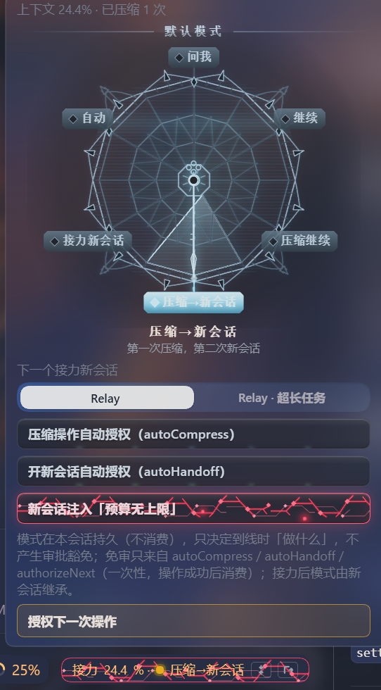

# dsh-context-relay

> 让 agent 在长任务里不走神、不走偏、越干越稳。

[English](README.en.md) · [npm](https://www.npmjs.com/package/dsh-context-relay) · [变更记录](CHANGELOG.md) · MIT

**DSH（DeepSeek Harness）上下文接力插件**：给 DSH 加两个可选的会话模式——**接力（Relay）** 与 **接力 · 超长任务**。它不换模型、不删历史，改的是长会话的组织方式：什么时候压缩、什么时候换新会话、怎么交接、哪些事该交给人来定。

## 它解决什么问题

一句话版：

1. 会话上下文始终待在高效区间，长任务不会越聊越飘；
2. 提高人机交互效率，让 agent 知道哪些问题该交给你判断；
3. 优化长任务、复杂任务的执行能力，降低偏移；
4. 配合官方智能体团队使用，获得双层架构，长任务能力再上一档。

### 1. 让会话上下文保持在高效区间

对话越长，agent 越容易遗忘、重复、过度发挥。本插件给会话设了「水位线」：

- 到线之前，agent 先把「接手这个活需要知道什么」整理成一页交接材料：目标、已定决策、证据、下一步；
- 然后压缩旧对话，把这一页放回对话里，接着干，不断片；
- 到更高的线时，把活交给一个全新会话，旧会话保留作审计；
- 压缩点放在阶段边界，不打断手上正在做的事；被一起收起来的补充说明和用过的技能，会提示「需要时重读」。

效果：长任务不必靠「一次把话说全」，而是在有限记忆里持续推进。

### 2. 提高人机交互效率：让 agent 知道哪些问题该交给你判断

判断标准很简单：会不会改变结果、边界或代价。会，才问人；不会，自己查。

- 能自己查清的事实先查清，只把真正需要你拍板的问题交上来，不拿琐事打扰你；
- 提问先说结论和影响，再给选项（推荐 + 默认 + 后果），等你一句话；
- 不可逆、对外、付费、凭据、删除这类动作，先停下来说清「做什么、为什么、怎么撤」，拿到明确同意才动；
- 同一类问题不重复问；你给过的答案会记住，并带进交接；
- 已经有智能体团队时，Lead 想再开一个独立子代理要先问你，不会绕开团队另起炉灶。

### 3. 优化长任务、复杂任务的执行能力，降低偏移

- 工作分五个阶段推进：摸清情况 → 定方案 → 动手 → 验收 → 交付；
- 进下一阶段有明确条件，每个阶段有完成标准，「做着做着换了目标」更难发生；
- 上下文到线只是「该不该换阶段」的闸门，不打断当前工作；
- 交付前必须让一个全新上下文的审查者独立核对「需求 ↔ 实现」，防止自己夸自己。

### 4. 配合官方智能体团队，获得双层架构，长任务能力再上一档

- 「超长任务」模式下，Lead 只负责拆活、派活、验收，具体实现交给队友，上下文压力分摊到两层；
- 队友上下文脏了可以原地擦干净重来（真清空），或者换个身份重来，工作记录仍保留；
- Lead 自己到线时交给新会话：旧会话树里还在跑的队友和后台任务会先被中断，新会话凭交接单和进度文件重建团队与工作记忆（不是原地接管旧团队）；
- 两层都能长期待在高效区间，长任务的上限被明显抬高；
- Lead 派活后不会空转等队友：队友回执会自动送达，只有真正被阻塞时才等一次，其余时间继续干活（省 token）。

## 两个模式怎么选

| 模式 | 适合 | 特点 |
|---|---|---|
| **接力（Relay）** | 大多数长任务 | Lead 自己干活；到线时按你选的方式压缩或换新会话 |
| **接力 · 超长任务** | 特别长、特别复杂、适合分工的任务 | Lead 只调度不亲手改代码，活派给队友；队友可清空、换代，长任务更耐跑 |

两个模式都保持「人来把关」：不自动循环、不替你自动批准。

## 安装

要求：DSH `>=0.2.1-rc.2`、Node.js `>=20`。

### 方式 A（推荐）：DSH Web UI 侧栏「插件」安装

全程在 Web UI 里完成，不需要命令行：

1. 打开 DSH Web UI，点左侧栏的 **「插件」**。
2. 点右上角 **「添加插件」**。旁边的箭头是「选择添加插件方式」菜单，其中「安装第三方插件」进入同一个对话框。
3. 在安装对话框的 **「插件包名」** 里填 `dsh-context-relay`；需要固定版本时在包名后加 `@版本号`。对话框也接受 Git 地址、压缩包或本地绝对路径。
4. **「安装源」** 保持默认即可：首次使用会自动在 npm 官方源与中国大陆镜像源之间探测，选先响应的那个；也可以手动选 npm 官方源 / 中国大陆镜像源 / 自定义 http(s) 地址。
5. 点 **「安装」**。Host 先读取这个包并在对话框里显示包名、简介与版本，pnpm 的命令和输出收在 **「查看安装详情」** 里。
6. 安装完成后点 **「立即启用」**；如果关掉了对话框，到「插件」页的「已安装插件」里打开 `dsh-context-relay` 组合包的开关。
7. 按页面提示 **重启/重载对应 profile**（启用 HMR 的 profile 会自动重组；否则重启 `dsh web`），然后 **刷新页面**。
8. 新建会话：模式选择器里应出现 **Relay** 与 **Relay · 超长任务**；选中任一模式后，输入框上方应出现状态条——两者都出现即安装成功。
9. （可选）「插件」页里 `dsh-context-relay` 的配置卡片可调水位线基准与面板默认值。

**排障**

- 装完看不到模式 → 确认组合包已启用、profile 已重载、页面已刷新；**安装成功不等于模块已激活**。
- 看不到状态条 → 只有接力会话会显示；重载前创建的旧会话使用旧的一套运行方式，新建会话即可。
- 需要升级 → 在「插件」页卸载后重新安装（本插件不是官方按需组合包，没有内置「更新」入口）。

### 方式 B：命令行

```console
dsh plugin --profile web add dsh-context-relay
```

也可以从 Git 仓库或本地目录安装：

```console
dsh plugin --profile web add github:rezon-aki/dsh-context-relay
dsh plugin --profile web add /path/to/dsh-plugins/dsh-context-relay
```

安装后同样需要重启/重载 profile、刷新页面，再新建接力会话。

## 装完是什么样

- 模式选择器多出 **Relay** 与 **Relay · 超长任务** 两个选项。
- 输入框上方多一条**状态条**（仅接力会话显示）：当前上下文用到多少、到没到线、现在是什么模式；点开就是面板。
- 记录过工作项之后，状态条旁边会多一个**台账胶囊**：`台账 3/8` = 未闭合 / 总数（进行中显示琥珀点、阻塞显示红点）；点开是完整的**工作台账面板**。
- 面板里你可以：
  - 选到线时的处理方式——继续 / 压缩继续 / 接力新会话 / 压缩→新会话（经典模式）/ 交给模型自动决定；选定后本会话一直生效，接力后新会话会继承；
  - 给「压缩」「交接」或「只下一次操作」开自动授权（开了就不再每次弹审批）；
  - 打开「预算无上限」：agent 会收到一句「你的 token 预算无上限」，让它敢花 token（只改提示词，不改系统配额）；
  - 看模型建议的做法（只是建议，不会自动执行）。
- 到线时会收到一条状态提醒（不是你的消息）：只报状态和「先把阶段内的事做完」，不打断当前工作。
- 压缩或换代时，顺手释放仍然占着的旧会话（内核通常已自动释放，这一项是兜底，不承诺省多少内存）。
- 超长任务模式还带队友管理：查看团队状态、给队友打检查点、原地清空、换代、跨会话重建。

### 界面截图

接力面板：默认模式表盘、自动授权、下一个新会话模式、授权下一次操作（真实界面）



## 日常怎么用

1. 新建会话时选 **Relay**（大多数情况）或 **Relay · 超长任务**，然后像平时一样提需求。
2. agent 会自己按阶段推进：该压缩时压缩、该交接时交接、该问人时问人。
3. 到线时按面板里你选的方式处理；没选过（问我）就先问你。
4. 想手动控制直接说，比如「压缩一下」「交接个新会话」「这次先问我」。
5. 到线提醒出现时不想理会也没关系，继续给指令即可——它不会擅自压缩或换会话。

## 多分支任务：工作台账

一个任务如果开了很多分支（几路调研、几个模块、几个队友各管一块），光靠「阶段 + 一页交接材料」容易丢项。工作台账把每条分支记成一条工作项：

- **字段**：编号（短 slug）、一句话标题、状态（待办 / 进行中 / 阻塞 / 已完成）、负责人、下一步、阻塞原因、证据、完成标准、依赖、所属阶段；
- **落盘**：`.scratch/context-relay/work-items.json`（工作区级，跨阶段、跨压缩、跨交接都在），agent 用 `relay_work_items` 工具维护；
- **对账**：交接时未闭合项自动变成新会话的「下一步」（最多 8 条，超出部分在交接单里列编号）；压缩材料自动带「未闭合工作项」段；切阶段会提示上一阶段的遗留；进「交付」阶段默认要求全部完成或阻塞（完成项要有证据）；
- **面板**：输入框上方 `台账 3/8` 胶囊，点开按状态分组看全部条目与负责人、下一步、证据、完成标准和依赖；只读，编辑一律走 agent 工具（保证校验和并发安全）；
- **团队**：队友只能更新自己名下的条目，Lead 可管全部；队友换代时负责人自动迁移到新代号；
- **提示词**：agent 的常驻提示词里带一小段台账纪律（多分支才用、什么时候更新、字段规则、交接/压缩会自动带未闭合项），所以它知道该记什么、什么时候记。

没有台账文件时，一切行为与旧版完全相同——它是可选的。

## 配置

宿主插件配置（可选，进阶项）：

| 键 | 默认 | 说明 |
|---|---|---|
| `threshold` / `settings.threshold` | 35 | 水位线基准（%）：提前 5 个点提醒，到基准线建议处理，再高 10 个点是硬线。 |
| `settings` | 六个字段的默认值 | 侧栏卡片的初始默认值；你在界面上保存的值优先。 |
| `thresholds` | 0.35 / 0.40 / 0.50 | 旧版阈值，只有没有界面设置来源时才用。 |
| `panelPath` / `settingsPath` | `~/.dsh/data/dsh-context-relay/…` | 面板和设置文件位置的覆盖。 |
| `workItems` | `true` | 启用工作台账（工具 + 闸门 + 面板）；`false` 完全回退旧行为。 |
| `workItemsGate` | `'strict'` | **交付（ship）阶段**的台账校验强度：`strict`（不合格拒绝）/ `warn`（只提示）/ `off`。交接与压缩始终把台账写进材料、文件损坏只警告（fail-open），不受本项影响。 |
| `workItemsPath` | `.scratch/context-relay/work-items.json` | 台账文件位置覆盖（相对路径按工作区解析）。 |
| `workItemsMax` | `30` | 台账条目上限（1–100）。 |
| `injectBrief` | `true` | 压缩成功后是否把那一页交接材料放回对话。 |
| `handoffApproval` | `'required'` | 压缩/交接必须走官方审批；没有审批界面的部署可以设 `'off'`（风险由部署方承担）。 |
| `inheritOnHandoff` | `true` | 交接后新会话沿用旧会话的模型和权限；`false` 则回部署默认。 |
| `releaseOnCompress` | `true` | 压缩后顺手释放当前 Lead 名下仍占着的已结束子会话和已退休队友身份（内核自然结束时通常已自动释放，一般无可释放）。 |
| `releaseRetiredGeneration` | `true` | 队友换代后，顺手释放旧身份仍占着的会话。 |
| `teamFirstSubagents` | `'ask'` | 已有团队时，Lead 开独立子代理要先问你；`'off'` 只保留协议文本。部署没有审批服务时不拦（只留文本）；`handoffApproval='off'` 时整道审批门不安装、本项不生效。 |
| `presetId` / `longPresetId` | `relay` / `relay-long` | 两个模式的内部 id。 |

侧栏设置（人类可改，热生效）：水位线基准 + 默认模式 / 自动决定 / 自动压缩 / 自动交接 / 预算无上限。

面板状态（按会话保存）：持久模式（不消费，接力后由新会话继承）、自动授权、自动决定记录、交接目标模式、预算无上限、模型建议等。

数据文件：`~/.dsh/data/dsh-context-relay/settings.json` 与 `panel.json`；对话内容仍由 DSH 自己存储。

## 技术参考：agent 工具与 HTTP 接口

| 工具 | 作用 |
|---|---|
| `relay_status` | 读当前上下文占用、到线状态、阶段、剩余预算和建议。 |
| `relay_phase` | 声明或切换阶段；校验进入条件和自查，交付阶段要求独立审查与汇报。 |
| `relay_organize` | 写那一页交接材料（自动附文档体检结论和关键文件索引）→ 官方压缩 → 材料注入回对话（含「压缩后需要时重读」提示）。每会话默认最多一次；人类在面板选『压缩继续』时按人类选择执行第二次（仍过审批）；无面板模式时第二次压缩需人类明确要求（`force`）。 |
| `relay_handoff` | 生成 ≤8KB 交接单（含滚动进度文件与工作台账），创建新接力会话并清理旧会话树。 |
| `relay_work_items` | 读写工作台账：无参数 = 读；Lead 整表替换（可带 `rev` 乐观锁）；队友用 `updates` 补丁只改自己名下条目的状态/下一步/证据/阻塞。 |
| `relay_recommend` | Lead 专用：把模型建议的做法写进面板（切阶段、压缩、交接、人类选择后清空）。 |
| `doc_lint` | 四项文档体检（配额 / 违禁措辞 / 索引 / git），输出 ≤2KB。 |

**接力 · 超长任务**另有团队工具：`relay_team_status`、`relay_renew`、`relay_rehydrate`（Lead）与 `relay_checkpoint`、`relay_freshen`（队友）。

HTTP（仅本机 GUI 认证后可用）：`GET/PUT /context-relay/settings`、`GET/PUT /context-relay/panel`、`GET /context-relay/api`（交接发布箱）、`GET /context-relay/work-items?sessionId=`（工作台账，供面板轮询）。

## 安全边界与代价

- **审批**：压缩和交接默认要你点头；免审只来自面板里的自动授权（「压缩」「交接」「只下一次操作」）。面板模式本身只决定「做什么」，不产生免审。
- **团队优先**：已有团队时，Lead 另开独立子代理要你确认；关掉该配置或部署没有审批服务时退化为协议文本。
- **交接会开新会话并消耗额度**：会中断旧会话树里正在跑的队友和后台任务，并迁移定时任务；旧会话标记为已交接，留作审计。
- **压缩有损**：旧对话细节只留在那一页材料里；重要结论请写进文档。
- **不自动循环**：relay 保持人来把关；重复性整块劳动请用官方 Ralph / workflow / subagent（有团队时开子代理需先确认）。
- **不可逆动作**：对外、付费、凭据、删除等先报备并取得明确同意，插件不会替你自动批准。

## 已知限制

- 插件重载前创建的旧会话仍走旧的一套运行方式；新行为以重载后新建的接力会话为准。
- 只在 DSH Web 环境验证；headless 等其它部署未验证。
- 压缩/交接的实际收益跟模型、任务长度有关，水位线不是对所有人都最优。
- 界面视觉细节没有自动化回归，安装后建议目检。
- 压缩的保真度和收益没做严格 A/B 对比；水位线拐点同样没有。
- 一个会话默认只压缩一次，避免摘要越压越漂；人类在面板把模式选为『压缩继续』时按人类选择执行第二次（仍过审批）；没有面板模式时第二次压缩需要人类明确要求（`force`）。
- 面板状态写盘失败时只留在内存里（重启即丢）；设置文件是持久化优先。
- 界面文案只有中文；文档以中文为准。
- 工作台账是**工作区级共享**：同一个工作区里的多个接力会话看到同一份台账（rev 乐观锁防互相覆盖）；面板只读，编辑走 agent 工具；条目上限默认 30，超限会拒绝写入并提示先关闭/归档已完成项（不会自动删）。
- 资源回收是兜底：内核在子会话自然结束时通常已自动释放，压缩时点通常没有可回收的（不承诺省内存）；只有换代时旧身份仍驻留等少数情况会真正释放。
- 团队优先的硬门按工具名精确匹配 `subagent` / `subagent_fork`，其它自定义派工工具不在覆盖内。

## 开发

```console
npm test        # node --test test/*.test.mjs
npm run check   # 全部入口语法检查
```

无构建步骤：host 与 client 都是手写 ESM；开发时可热注入，发布为 bundle（`cordis.patch.yml`）。

`lib/policy.js`（纯策略函数）、`lib/panel-store.js`（面板状态）、`lib/agent.js` + `lib/agent/*`（preset 平面）、`lib/index.js`（Host 平面/HTTP）、`lib/client.js`（Web UI bundle）、`lib/preset-base.js`（PTC preset 资产）、`skills/`（随包技能）。

变更记录见 [CHANGELOG.md](CHANGELOG.md)。

## License

MIT
