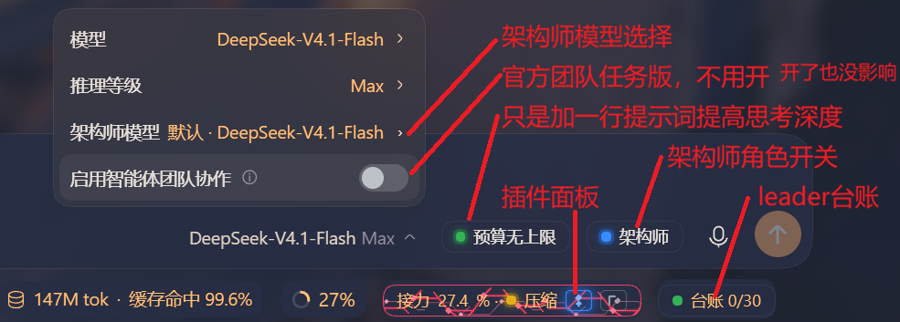
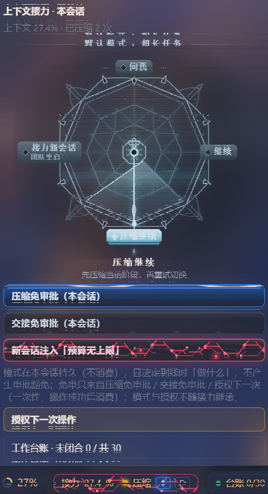
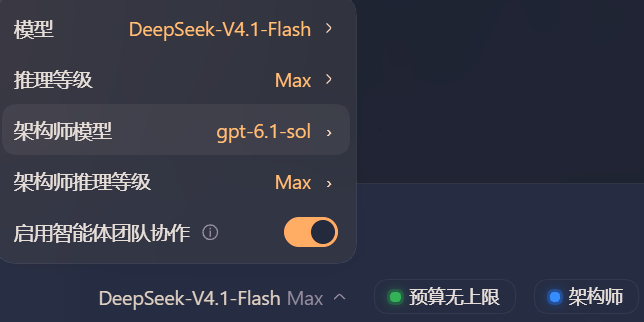

# dsh-context-relay

[](https://github.com/rezon-aki/dsh-context-relay)

> 以官方子智能体为基础的双层架构 agent套件，leader负责专职对接用户+团队管理，文档治理+链式记忆，维持最小必要上下文+按需调取文档，全团队保持低上下文高效工作，偏移实现、偷懒实现矫正/验证，人机交互优化，测试验证只用最小必要+重型验证测试需用户同意，可独立配置模型和思考强度的超低上下文无污染无负担专职敲定工程实现的架构师，“你的token预算无上限”开关用一句提示词强化dsh41f的思考深度。

[English](README.en.md) · [npm](https://www.npmjs.com/package/dsh-context-relay) · [变更记录](CHANGELOG.md) · [迁移说明](docs/design/MIGRATION.md) · MIT

**DSH（DeepSeek Harness）的长任务插件。** 装上后只有一个模式：**接力模式（Relay）· 超长任务**。它让 agent 在很长的会话里保持清醒——上下文快满了自己整理，到线了提醒你，需要换新会话时把该带走的都带上；还可以把活分给一支固定小队：Lead 负责拆活和验收，队友负责干活。

它不换模型、不删你的对话，也不替你拍板。

## 快速介绍



输入框下方的菜单：模型、推理等级、架构师模型、启用智能体团队协作。

## 它解决什么问题

1. **上下文一直待在高效区间**：长任务不会越聊越飘、越聊越贵；
2. **只在该问你的时候问你**：能自己查清的自己查，真正需要你拍板的，一次说清；
3. **分阶段推进**：每一阶段有明确的开始与完成标准，减少「做着做着跑偏」；
4. **配官方智能体团队组成双层架构**：执行压力分给队友，长任务的能力上限更高。

### 1. 让上下文保持在高效区间

对话越长，agent 越容易忘事、重复、过度发挥。插件给会话设了几道「水位线」（默认值，可在面板里改）：

- **上下文用到约三成**：提醒你一次——只是提醒，不打断；
- **到基准线（默认 35%）**：建议处理，可以压缩；
- **再高一档（默认 45%）**：建议换一个新会话接力。

怎么处理由你（或面板里的设置）决定，插件不会擅自压缩或换会话。

### 2. 该问的才问

判断标准很简单：会不会改变结果、边界或代价。会，才问；不会，自己查。

- 先把事实查清，再把真正需要你拍板的问题一次问清（结论、选项、推荐、不选的后果）；
- 不可逆、对外、付费、凭据、删除这类动作，先说清「做什么、为什么、怎么撤」，等你明确同意才动；
- 你答过的问题不重复问，答案会带进下一次接力。

### 3. 分阶段推进，减少跑偏

- 工作按五步走：摸清情况 → 定方案 → 动手 → 验收 → 交付；每一步都有完成标准；
- 上下文到线只是「该不该换阶段」的闸门，不会打断手头正在做的事；
- 交付前会先让你确认设计，再让一个全新上下文的审查者独立核对「做的是不是你要的」。

### 4. 双层团队

- 唯一模式下，Lead 只负责拆活、派活、验收，具体实现交给队友，上下文压力分摊到两层；
- 队友上下文脏了，可以原地擦干净重来，或者换个身份重来，工作记录不丢；
- Lead 自己到线时交给新会话：旧会话里正在跑的队友和后台任务会先被中断；交接只保证**链式记忆可取**（`chain.ndjson` + progress + 交接指针，需要时用 `session_event_read` 按 seq 回读），**不保证队伍回来、不重建、不回放**；`adopt` 只认当前 live tree（历史名字即使 live 也 already-known）；`allowSpawn=true` 只影响 `renew`/`dispatch` 新开成员，不是交接恢复入口；
- Lead 派活后不会干等：队友的回执会自动送达，只有真被卡住时才等一次。

## 装之前先知道

- **只有一个模式**：接力模式（Relay）· 超长任务（内部 id `relay-long`）。适合特别长、特别复杂、能分工的任务；短任务不需要它。
- **人始终在把关**：不自动循环，也不会替你自动批准。压缩和交接默认要你点头；免审只来自你在面板里开的自动授权。
- **压缩有损**：旧对话的细节只留在那一页交接材料里；重要结论请写进文档。
- **交接会开新会话**：会中断旧会话里正在跑的队友和后台任务，并迁移定时任务；旧会话保留作审计。
- **版本要求**：DSH `>=0.2.2-rc.2`（只支持这一代内核）、Node.js `>=20`；目前只在 DSH Web 环境验证过，headless 未验证。
- **v0.10.0 是破坏性版本**：旧的 classic `relay` 别名、双模式配置、旧配置键都已删除，面板授权契约版本升到 3（升级后旧授权一次性失效，模式和架构师设置保留）。升级前先看[迁移说明](docs/design/MIGRATION.md)。
- **v0.11.0 调整默认值**：容量线 55%（独立配置）、spawn 默认关、默认只显示当前小队、ship 后返修需显式 reopen、宿主压缩兜底；完整变更见 [CHANGELOG.md](CHANGELOG.md) 与迁移说明。
- **v0.12.0 细化行为（无迁移）**：按风险配门禁（T0 文档改动可免设计门与独立审查，但须带实际 diff 证据；T2 全门）、T2 设计门回显用户原话与不做清单、输出统一说明式（v0.13 起为三问）、文档索引 A/B/C 分层与注入计量、按角色裁剪工具与技能、constraints/contracts/relations 语义层；完整变更见 [CHANGELOG.md](CHANGELOG.md)。
- **v0.14.0-dev（未发布）契约收紧**：工具返回只作内部事实（状态/发生了什么/卡在哪/下一步/证据/风险），不再产任何用户段；Lead 自己写三问，需要裁决时当场给卡片；失败/部分成功带 `effects`/`retryable`/`next`；`collect` 未验证明示 `unverified`，handoff 清理 skipped 写“未检查/不适用”。

## 安装

### 方式 A（推荐）：在 Web UI 里点几下

1. 打开 DSH Web UI，点左侧栏的 **「插件」**；
2. 点右上角 **「添加插件」**，在对话框的 **「插件包名」** 里填 `dsh-context-relay`（要固定版本就写成 `dsh-context-relay@版本号`；也接受 Git 地址、压缩包或本地路径）；
3. **「安装源」** 保持默认即可（会自动在 npm 官方源与国内镜像之间选先响应的那个），也可以手动指定；
4. 点 **「安装」**，装完点 **「立即启用」**；如果关掉了对话框，到「已安装插件」里打开 `dsh-context-relay` 的开关；
5. 按页面提示 **重启/重载 profile**（开了热更新的 profile 会自动重组），然后 **刷新页面**；
6. 新建会话，在模式选择器里选 **接力模式（Relay）· 超长任务**：输入框上方出现状态条，就说明装好了。也可以先建普通会话再切过去——首轮前或会话中都可以。

### 方式 B：命令行

```console
dsh plugin --profile web add dsh-context-relay
```

也可以从 Git 仓库或本地目录安装：

```console
dsh plugin --profile web add github:rezon-aki/dsh-context-relay
dsh plugin --profile web add /path/to/dsh-plugins/dsh-context-relay
```

装完同样需要重载 profile、刷新页面，再新建或切换接力会话。

### 装完看不到？

- **看不到「接力模式」**：确认组合包已启用、profile 已重载、页面已刷新。安装成功不等于模块已激活。
- **看不到状态条**：状态条只在接力会话显示；在模式选择器里切到 Relay 即可（切换后自动生效，不用重建会话）。
- **升级/重载后旧会话行为不对**：切一次模式，或新建会话。
- **要升级插件**：在「插件」页卸载后重新安装（这个插件没有内置的「更新」按钮）。

## 装完之后

- 模式选择器里只有 **接力模式（Relay）· 超长任务** 一个生产模式。
- 输入框上方多一条**状态条**（只有接力会话显示）：上下文用了多少、到没到线、现在是什么模式；点开就是面板。
- 记过工作项后，状态条旁会多一个**台账胶囊**（`台账 3/8` = 未闭合/总数，进行中是琥珀点、阻塞是红点），点开是完整清单。
- 上下文到线时会收到一条**状态提醒**（不是你的消息）：warn 提示「现在就该动手」（压缩/清空复用/交接三选一）；organize/relay 是兜底告警；容量线（默认 55%）是最坏兜底。它不会自动执行，也不打断你。

### 面板里能改什么

- **到线怎么处理**：问我 / 继续 / 压缩继续 / 接力新会话。默认「问我」；没在面板里改过的会话，新会话默认「压缩继续」。
- **自动授权**：给「压缩」「交接」或「只下一次操作」开自动授权，开了就不用每次点同意（随时能关）。
- **预算无上限**（输入框模型选择器右边的小胶囊）：打开后 agent 会收到一句「你的 token 预算无上限」，让它敢花 token——只改提示词，不改系统真实配额。Lead 的开关会继承给它新建的队友、架构师和 worker；已在跑的队友会在下次清空复用（freshen）或架构师继续时同步。
- **模型建议**：只是建议，不会自动执行。

### 日常怎么用

1. 新建会话选 Relay（或建好后切过去），然后像平时一样提需求；
2. agent 会自己按阶段推进：该整理时整理，该提醒时提醒，该问人时问人；
3. 到线提醒出现后，按面板里设定的方式处理；没设置（问我）就先问你；
4. 想手动控制直接说，比如「压缩一下」「交接个新会话」「这次先问我」；
5. 不想理提醒也没关系，继续下指令即可——插件不会擅自压缩或换会话。

### 界面截图

接力面板：表盘（问我 / 继续 / 压缩继续 / 接力新会话）、压缩免审批、交接免审批、授权下一次操作、新会话注入「预算无上限」，以及工作台账：



## 它会替你做什么、什么时候会来问你

### 到线与处理

- **到线分四档**：起点主动管理；warn 30% 是「现在就该动手」（压缩/清空复用/交接三选一）；organize/relay 是兜底告警；容量线 55%（独立配置）是最后防线。状态提醒不打断你，也不自动执行。
- **你选「压缩继续」或明确说压缩**：agent 先把「接手这个活需要知道什么」整理成一页（目标、已定的事、证据、下一步），压缩旧对话，把这一页放回对话里，接着干。
- **你选「接力新会话」或上下文到硬线**：生成交接单，开一个新会话并把摘要发给它；旧会话保留。旧会话里的队友和后台任务会被中断，定时任务迁到新会话。
- 一个会话默认只压缩一次（避免摘要越压越漂）；你在面板里选「压缩继续」可以再来一次，仍然要过审批。
- **容量保全线**（默认 55%，`settings.capacityThreshold` 独立配置）：到达后立即收尾当前动作、停止开新活/派活，先写 brief/progress/台账，再按模式/授权压缩或交接；不自动执行。

### 分阶段与两个用户确认点

每个阶段有明确的开始与完成条件。交付前有两个必须对齐的点：

1. **设计门（T2 开工前）**：先把设计（怎么做、动哪些地方、怎么验收、有什么风险）交给你确认；你确认了才动手。T1 的设计写进阶段目标（≤1 页），T0 不写独立稿。
2. **完成前独立审查（交付前）**：让一个全新上下文的审查者核对「需求 ↔ 实现」有没有偏移、缩水、偷懒、缺失——防止实现者自己夸自己。审查和其他验收并行，不串成一道长流程。

验收默认只做最小必要：跑目标测试 + 一次独立 diff 审查 +（必要时）一次语法检查。全量回归、真机验证、大样本、多轮审查这类「重型验证」默认不做，需要你明确同意。

- **按风险配门禁**：改动分 T0（文档/琐碎）、T1（局部代码）、T2（公开面/数据格式/权限/不可逆或大改）。T0 可跳过设计门与独立审查，但必须带实际 diff 证据（`paths` + `lines`，仅文档且 ≤20 行；只写 reason 会降为 T1）；T1 保留一次 diff 审查（同 diff 复用审查结论须带 `diff_hash`，reopen/新任务清空）；T2 全门照旧。用户可见行为、工具 schema/返回契约、`lib/index.js` 等公开面自动升 T2；分级可随 `relay_phase` 的 `risk` 显式指定，也可自动判定（未知按 T2 保守处理）。

### 汇报与提问

- 对你说人话：不贴命令输出、日志、长 diff，不堆内部字段和术语；术语第一次出现会解释。
- 交付前的汇报默认三问：你看到什么 → 要你做什么 → 有什么影响，默认不超过 600 字；要细节或 ship 长报告时再用四段。
- **工具返回不是用户话**：状态、交接、收口与失败结果只给 Lead 内部事实（原因/已经发生什么/能否重试/下一步/证据/风险），由 Lead 自己组织成三问；不产「用户段」，也不要求原样转发。
- **要你拍板时必须当场给卡片**：问题、选项 A/B、各自影响面、收益/风险、推荐、默认、不选会怎样；文档只作证据，不能只说“在文档里”。
- 能自己查清的事实先查清，只把真正需要你拍板的问题一次问清（带推荐、默认、后果）。
- 不可逆、对外、付费、凭据、删除这类动作，先报备「做什么、为什么、怎么撤」，拿到明确同意才动。

## 团队：Lead、队友和架构师

- **固定小队，默认上限 8 人（含架构师）**，`squadMax` 可上调；**spawn 默认关闭**，优先复用现有人手；没有可用队员时，让现有队员清空复用、把历史成员纳入小队（adopt）；phase 边界交接只归档旧会话，**不重建小队**，要新成员须把 `allowSpawn` 设为 true 再 `dispatch`/`renew`（或手工开官方 subagent）。
- **Lead 只做调度**：拆活、派活、验收；具体实现交给队友。队友会收到一张标准派活单：目标、必读材料、能改哪些文件、怎么验收、回执放哪。
- **按角色裁剪**：human-loop 技能只注册给接力 Lead（`context-relay`/`doc-governance` 全局可用）；`doc_lint` 与需要人拍板的问题（`ask_user_question`）只给 Lead；teammate 保留 status/phase/doc 与 checkpoint/freshen，worker 只余 `relay_doc`（brief/handoff 的有界读）；架构师与 worker 裁 `relay_status` 和 `relay_phase`。工具名与参数不变。
- **换人优先全清复用**：让队友先 checkpoint，再 `relay_freshen({reset:true,brief})` 真清空（同成员、0 额度）；只有换身份/角色且 `allowSpawn=true` 才用 `relay_renew`。历史成员默认隐藏、不派活；需要时用 `relay_team_status({manage:{action:'adopt',...}})` 纳入，或 `manage:{action:'retire',scope:'legacy',...}` 批量清理（catalog 名字不删；真清空团队用交接）。
- **不会一直催队友**：队友的回执会自动送达，Lead 不会空转轮询（省 token）。

### 专职架构师

长任务里最贵的是「路线没想清就开写」。这个模式给团队配一个固定的**架构师队友**（名字固定为 `architect`，长期只建一支）：

- **Lead 做两件事**：和你对齐需求（边界/验收/取舍）、读项目文档了解现状；
- **架构师把需求变成工程路线**：每次任务都以低上下文开始，只读必须的材料，产出一份工程实现文档（需求对齐、技术路线、模块接口、风险取舍、待决策、实现步骤与验收）；
- **需要你拍板的**：架构师在「待决策」里写清问题/选项/影响面/收益风险/推荐/默认/不选后果并报给 Lead；Lead 必须把它翻成**裁决卡直接问你**（文档只作证据），再把结论回给架构师——架构师不直接问你，也不替你决定；
- **开关**：输入框里「预算无上限」旁边的「架构师」小胶囊（只对接力会话显示，默认开），按会话控制是否把路线交给架构师；
- **模型**：点开输入框的模型选择器，「模型 / 推理等级」下面有「架构师模型 / 架构师推理等级」两行，默认跟随你选的模型，也可以单独指定（显式指定需在官方子代理白名单内）。



在输入框的模型菜单里设置「架构师模型 / 架构师推理等级」；默认跟随你的模型，也可单独指定。

## 工作台账：它自己的阶段待办清单

长任务跑着跑着容易偏：忘了本来要做什么、做到哪了。台账把「这一阶段要做哪几件事」变成一张清单：

- 开新阶段时列好分点（1–8 条），需要时随时补；
- 干活时会提示当前分点和下一步；改完文件却没更新清单会提醒一次；
- 切阶段时，未完成的项会提醒收口，或明确带到下一阶段；
- 清单会随压缩/交接带到新会话，不会断档；
- 面板上的胶囊可以查看全部条目（只读，编辑由 agent 完成）；
- **完成确认门**：分点从「未完成」改成「已完成」前，Lead 必须确认三项均为 true：无偏移（no_drift）/ 无缺失（no_missing）/ 无回退（no_regression），先复核 diff、需求与测试；缺失或不完整会被 `done-gate` 拒绝（整表零副作用），收口 done 回执走 `relay_collect` 时同口径返回 `confirmation-required`（条目不置 done、台账不变）。
- 台账是可选的：没有台账时，一切行为和没有它一样。默认上限 30 条，超了先把已完成的归档。

## 配置（进阶，可选）

宿主插件配置：

<!-- config-table:begin (generated by scripts/gen-config-table.mjs; do not edit) -->
| 键 | 默认 | 说明 |
|---|---|---|
| `threshold` / `settings.threshold` | 35 | 水位线基准（%）：提前 5 个点提醒，到基准线建议处理，再高 10 个点是硬线。v0.10.0 起这是阈值的唯一来源。 |
| `settings` | 六个字段的默认值 | 面板的初始默认值；你在界面上保存过的值优先。 |
| `settings.capacityThreshold` | `55` | 容量保全线（%，20–95，独立于 band 阈值；调回 85 接近旧行为）。 |
| `allowSpawn` | `false` | 是否允许 dispatch/renew 新建成员；false 时换人只能 reset 复用/adopt/handoff。 |
| `squadMax` | `8` | 小队上限（含架构师，可上调；32 为防御上限）。 |
| `contextCheck` | `'on'` | 新 phase/新任务起点自查提醒；`'off'` 全静默。 |
| `reopenGate` | `'strict'` | ship→build/verify 返修闸门：`strict` / `warn` / `off`（off=v0.10 旧行为）。 |
| `compactionFallback` | `'on'` | 宿主自动压缩归因兜底：host 归因写最小恢复快照+一次 notice；`off` 只日志。 |
| `receiptVerify` | `'warn'` | 回执/审查证据校验档：`warn`（默认；缺 commit/verification 只标 unverified）/ `strict`（缺即拒）/ `off`（不校验）。 |
| `strictToolArgs` | `false` | 工具 schema 外的参数：`false`（默认）只记 JSONL + warn，`true` 直接返回 invalid-args。 |
| `panelPath` / `settingsPath` | `~/.dsh/data/dsh-context-relay/…` | 面板和设置文件的位置。 |
| `architect` | `true` | 架构师开关的默认值（输入框「架构师」小胶囊按会话覆盖）。 |
| `workItems` | `true` | 启用工作台账；设为 `false` 完全回到旧行为（与「执行活先派活」的协议冲突，装载时会提示）。 |
| `workItemsGate` | `'strict'` | 交付阶段的台账校验强度：`strict` 不合格拒绝 / `warn` 只提示 / `off`。压缩和交接始终把台账写进材料，不受本项影响。 |
| `workItemsPhaseGate` | `'warn'` | 切阶段时的收口提示：`warn` 提醒后放行 / `strict` 拒绝切阶段 / `off`。单线程小任务用空分点声明放行。 |
| `delegationGate` | `'warn'` | build→verify 的派活闸门：`warn` 只提醒 / `strict` 命中即拒 / `off`。检查 Lead 亲自执行的占比是否过高、分点是否该由 Lead 自己做的却派了 worker。 |
| `workItemsPath` | 按会话 | 台账文件位置；显式设置则所有会话共用一份。 |
| `workItemsMax` | `30` | 台账条目上限（1–100）。 |
| `injectBrief` | `true` | 压缩成功后是否把那一页交接材料放回对话。 |
| `handoffApproval` | `'required'` | 压缩/交接默认走官方审批；没有审批界面的部署可以设 `'off'`（风险自担）。 |
| `inheritOnHandoff` | `true` | 交接后新会话沿用旧会话的模型和权限；设为 `false` 则回部署默认。 |
| `longPresetId` | `'relay-long'` | 唯一模式 id（一般不用改）。 |
| `docs.select` | `true` | 文档索引 v2 的选择面（在役/决策单列 + 目录折叠）。设为 `false` / `'legacy'` / `'off'` 真回滚 v0.11 渲染：L1/L2 全单列 + 折最大目录组 + 历史尾行，无 A/B/C 层级。 |
| `docs.layout` | `true` | 索引的宽度/组数自动分层（W/G）。设为 `false` / `'flat'` / `'off'` 关闭 W/G（不再因宽度或组数降级）。缺省字节预算 0 = 不限，层级只由显式 docs.width / docs.maxGroups 触发。 |
| `docs.metrics` | `true` | index/read/search 是否写 `.scratch/context-relay/metrics/<session>.ndjson`，以及 `relay_status.docs` 摘要。设为 `false` / `'off'` 完全不写事件、status 无 docs 块。 |
| `docs.width` | `0` | 单列条目的显示列预算（CJK/emoji 按 2 列）：缺省 `0` = 不限（不按宽度折叠）；正整数才触发 A→B，B 层 pin 仍超则 C。`docs.layout` 关掉后本项不参与分层。 |
| `docs.maxGroups` | 不设（不触发 G） | 显式组数上限（整数 ≥0）：目录组数超过它则降 C（设 0 且存在组时直接 C）。只有显式配置才启用 G。 |
<!-- config-table:end -->

侧栏设置（人类可改，热生效）：水位线基准 / 默认模式 / 默认自动压缩授权 / 默认开新会话授权。「预算无上限」和「架构师」不在侧栏：开关在输入框里按会话控制，默认值分别来自 `settings.unlimitedBudget`（默认 true）和配置 `architect`（默认 true）。

数据文件：`~/.dsh/data/dsh-context-relay/settings.json`、`panel.json`；对话内容仍由 DSH 自己存储。

## 常见问题

**Q：装完为什么没有「接力模式」？** 见上面「装完看不到？」——通常是组合包没启用、profile 没重载，或页面没刷新。

**Q：上下文都到线了，为什么没自动压缩/交接？** 默认要你点头；在面板里开「自动授权」后才会自动执行。模式只决定「做什么」，不等于授权。

**Q：升级后自动授权怎么没了？** v0.10.0 把面板授权契约升到版本 3，旧授权一次性失效；重新在面板里开一次即可，模式和架构师设置会保留。

**Q：关掉「预算无上限」，队友还会收到那句提示吗？** 之后新建的队友/架构师/worker 会继承「关」；已在跑的队友会在下次清空复用（freshen）或架构师继续时同步。

**Q：队友上下文脏了/卡住了怎么办？** 让 Lead 让队友先 checkpoint，再 `relay_freshen({reset:true,brief})` 原地清空复用（保留工作记录、同成员、0 额度）；只有换身份/角色且 `allowSpawn=true` 才 `relay_renew`。历史成员要先 `manage.adopt` 才能派活。

**Q：会删掉我的对话吗？** 不会。压缩只是压缩——旧对话细节不再出现在当前上下文里，历史仍由 DSH 保存；交接的新旧会话都会留着。

**Q：卸载会删我的数据吗？** 不会。只注销插件能力，保留 `panel.json`、`settings.json` 和工作区 `.scratch/context-relay/`；要清理请先备份，再手动删除。

**Q：能在 headless 或别的部署里用吗？** 目前只在 DSH Web 环境验证过，其它部署未验证。

## 已知限制与注意事项

- **审批与授权**：压缩和交接默认要你点头；免审只来自面板里的自动授权。模式本身只决定「做什么」，不会产生免审。
- **小队默认只显示当前代**：legacy（历史成员）与 retired 默认隐藏、不可派活；用 `include_legacy`/`include_retired` 查看，adopt 纳入或 retire 清理；catalog 名字不能删除，退休不可逆。
- **容量线窗口未知时不判定**：投影/计量缺失时容量提醒静默，band 的绝对 token 兜底照旧。
- **reopen 计数**：投影可用时 `relay_status.reopen` 走进程缓存，冷启动可能先显示 0，待无投影扫描或后续 reopen 校正。
- **内核版本**：只支持 DSH 0.2.2-rc.2 这一代。内核形状对不上时，插件会降级并给出提示（`relay_status.plane.degradations` 可查），不会静默失败，也不会拒绝打开会话。
- **PTC 程序通道是软约束**：工具面的裁剪只隐藏模型侧的 `bash`/`pwsh`/`write`/`edit` 调用；`run_code` 里用 `node:fs` 或子进程仍能直接读写文件。插件不做通道守卫（这是已经定下的取舍），靠协议、自查和回执约束，不承诺硬隔离。
- **交接有成本**：会开一个新会话、消耗额度，中断旧会话里正在跑的队友和后台任务，并迁移定时任务；旧会话保留作审计。
- **压缩有损**：旧对话细节只留在那一页材料里，重要结论请写进文档。
- **不做自动循环**：保持人来把关；重复性整块劳动请用官方的 Ralph / workflow / subagent。
- **压缩/交接的收益取决于模型和任务**：水位线不是对所有人都最优，也没有做过严格的 A/B 对比。
- **只验证了 Web**：headless 等其它部署未验证；界面视觉细节没有自动化回归，装完建议自己看一眼。
- **一个会话默认压缩一次**：避免摘要越压越漂；面板选「压缩继续」可以再来一次，仍然过审批。
- **面板状态**：写盘失败时只留在内存里（重启会丢）；设置文件是持久化的。
- **界面文案只有中文**：文档以中文为准。
- **工作台账是会话级、Lead-only 的**：同一个工作区的多个接力会话各有一份；队友/子代理不读写 Lead 的台账，面板只读。条目上限默认 30，超了先归档已完成的项，不自动删除。
- **资源回收不承诺**：内核在子会话自然结束时会自动释放；插件只保留内部句柄用于换代容量，不承诺「压缩后释放内存」。
- **preset 可以切换**（v0.10.0 起）：切换或插件重载后旧会话会被幂等回填，不再要求新建会话；如果 `relay_status.plane.installed` 为 false，看 `degradations` 定位缺哪个能力，或切一次模式/新建会话。
- **架构师模型默认跟随你的模型选择**：显式指定时必须在该会话的官方子代理白名单内。

## 升级与卸载

**v0.14.0-dev（未发布；无数据迁移）**：工具只返回内部事实，删除用户段/`user_visible`；Lead 自写三问、裁决必须给卡片；协议补风险档免门矩阵；handoff 恢复文案改为只保证链式记忆可取（不重建/不回放/不新增只读入口）；失败与部分成功带 `effects`/`retryable`/`next`。

**v0.13.0 是「用户段材料层」版本（已被 0.14.0-dev 取代）**：工具默认 `[给用户]` 三问、默认沉默、`manage.maintain`、回执证据、`review_ref`、参数 warn、配置表单一真源、legacy golden、风险档落盘与 `isDocItem` 路径优先；工具数与数据格式不变。

**v0.12.0 是行为细化版（无数据迁移）**：风险分级门禁、T2 设计门回显、说明式输出（v0.13 起为三问）、文档索引 v2、角色裁剪与 constraints/relations 语义层；旧 T2 `design_gate` 调用需补 `ask_ref`/`not_doing`，工具数与数据格式不变。

**v0.11.0 是默认值/行为变更版（无数据迁移）**：容量线 85%→55% 独立配置、spawn 默认关、默认只显示 squad、到线四档语义、ship 返修需 reopen、宿主压缩兜底；回退映射见[迁移说明](docs/design/MIGRATION.md)。

**v0.10.0 是破坏性版本**（从 0.8.x 直接升）：`panel.json` 的 `schemaVersion` 升到 3，旧文件里的会话授权一次性失效（自动压缩/自动交接/授权下一次需要重新开启；模式和架构师设置保留）；classic `relay` 别名、`routerMode`/`legacyPresetCompat`、`config.thresholds`、cth/autoChoose/autoDecision/handoffPreset、`relay_phase` 的 `next_operation` 等旧接口全部删除。旧的 classic 会话打开后，在模式选择器里切到 Relay 即可回填。完整清单和升级步骤见[迁移说明](docs/design/MIGRATION.md)，逐版本记录见 [CHANGELOG.md](CHANGELOG.md)。

**卸载**：注销 preset、技能、HTTP、工具、投影和哨兵，但保留用户数据（`panel.json`、`settings.json`、工作区 `.scratch/context-relay/`）。需要清理时先备份，再手动删除——插件不会自动删数据。

## 开发

```console
npm test        # node --test test/*.test.mjs
npm run check   # 全部入口语法检查
```

没有构建步骤：host 和 client 都是手写 ESM；开发时可以热注入，发布为 bundle（`cordis.patch.yml`）。

主要目录：`lib/policy.js`（策略单源）、`lib/risk.js`（风险分级与门禁键）、`lib/output.js`（内部事实渲染与 notice 文案）、`lib/docs-policy.js` + `lib/docs-metrics.js`（文档索引 v2 与注入计量）、`lib/skills.js`（角色技能注册）、`lib/seams.js`（官方 seam 契约）、`lib/plane/`（角色表与幂等 reconcile）、`lib/storage.js`（原子写/锁）、`lib/panel-store.js`（面板状态）、`lib/agent.js` + `lib/agent/*`（preset 平面与工具）、`lib/agent/notice/`（提醒规划/投递）、`lib/index.js`（Host 平面/HTTP）、`lib/client.js`（Web UI）、`lib/preset-base.js`（PTC preset 资产）、`skills/`（随包技能）。

## 进阶参考（给想深入的人）

更细的设计与实现见：

- [架构说明（ARCHITECTURE）](docs/design/ARCHITECTURE.md)：分层、9 个官方 seam 契约与降级、agent 平面、持久化/策略/提醒分层、阶段与台账契约；
- [设计说明（DESIGN）](docs/design/DESIGN.md)：定位、设计目标、边界与验收口径；
- [迁移说明（MIGRATION）](docs/design/MIGRATION.md)：v0.11.0 默认值变更与回退映射，以及 0.8.x → v0.10.0 的破坏性变更。

### 工具与接口

共 15 个工具：8 个 preset 常驻（其中 `relay_recommend`/`relay_organize`/`relay_handoff`/`relay_work_items`/`doc_lint` 仅 Lead 可用）+ 5 个 Lead 专属（`relay_team_status`/`relay_renew`/`relay_architect`/`relay_dispatch`/`relay_collect`）+ 2 个队友工具（`relay_checkpoint`/`relay_freshen`，架构师只用前者）。工具与技能按角色裁剪（`human-loop` 只随 Lead 注册；`context-relay`/`doc-governance` 全局可用）：

| 角色 | 工具面 | 技能 |
|---|---|---|
| Lead（root） | 13 个 relay 工具（含 `doc_lint`）+ 宿主的人类接口 `ask_user_question`；`bash`/`pwsh`/`write`/`edit` 被隐藏 | `context-relay`、`doc-governance`、`human-loop` |
| teammate（直接队友） | `relay_status`/`relay_phase`/`relay_doc` + `relay_checkpoint`/`relay_freshen` | `context-relay`、`doc-governance` |
| 架构师 | `relay_doc` + `relay_checkpoint` | `context-relay`、`doc-governance` |
| worker（普通子代理） | 只保留 `relay_doc` | `context-relay`、`doc-governance` |

三类子智能体都裁掉 `doc_lint`、`ask_user_question` 与 Lead 专属工具（`relay_organize`/`relay_handoff`/`relay_recommend`/`relay_work_items`）；架构师与 worker 另裁 `relay_status` 和 `relay_phase`。

| 工具 | 作用 |
|---|---|
| `relay_status` | 看上下文占用、到线状态、阶段、剩余预算、派活/执行占比、平面自检、小队摘要（teamSummary）与 reopen 记录。 |
| `relay_phase` | 声明/切换阶段；T2 首次进 build 校验设计门（T1 设计写进阶段目标，T0 不写独立稿）；交付阶段要求独立审查与汇报；ship 后返修用 `reopen{reason,user_approved}`，ship→discover 标新任务。 |
| `relay_organize` | 写交接材料 → 官方压缩 → 把材料放回对话。每会话默认一次。 |
| `relay_handoff` | 生成交接摘要与完整交接单，创建新接力会话并清理旧会话树；只保证链式记忆可取，不重建小队；清理失败返回部分成功事实。 |
| `relay_work_items` | 读写 Lead 自己的工作台账（无参数=读；整表替换可带乐观锁）。 |
| `relay_recommend` | Lead 把模型建议写进面板（只做提示，不改变你的决定权）。 |
| `doc_lint` | 文档体检（配额/违禁措辞/索引/git），输出 ≤2KB。 |
| `relay_doc` | 会话文档的分层与索引：`index` / `list` / `read` / `search` / `lint` / `related`。 |
| `relay_dispatch` | Lead 取分点 → 复用或新建 worker → 发标准派活单（目标/必读/写范围/验收/回执）。 |
| `relay_collect` | Lead 短等回执（≤120s），只读回执头 + 摘要，校验新鲜度后把分点置 done/blocked；未验证会标 `unverified`，不冒充“全部完成/已核对”。 |
| `relay_team_status` | 团队体检（默认只当前小队）：健康/档位/检查点/派活计数/reset 结果；`include_legacy`/`include_retired` 查看历史；`manage` 做 retire/adopt/maintain；状态没变的重复查询会被拒绝。 |
| `relay_renew` | 队友换代（默认关闭；只换身份/角色且 `allowSpawn=true` 才用）。 |
| `relay_architect` | 创建/续用固定架构师（`fresh` 换新上下文 / `continue` 接着设计）。 |
| `relay_checkpoint` | 队友/架构师写检查点（结论/完成/决策/证据/约束/未决/下一步）。 |
| `relay_freshen` | 队友同任务内减压；`{reset:true, brief}` 真清空并换新 brief。 |

HTTP（仅本机 GUI 认证后可用）：`GET/PUT /context-relay/settings`、`GET/PUT /context-relay/panel`、`GET /context-relay/architect-models?sessionId=`、`GET /context-relay/work-items?sessionId=`（只读）。

### 文档分层与注入边界

- 跨会话文档分三层：L0 索引（自动生成、带「何时读」）→ L1（交接单/阶段材料/进度/经验，新会话先读）→ L2（架构/设计/决策，按需取）；`relay_doc` 负责读和查（`index`/`list`/`read`/`search`/`lint`/`related`），`doc_lint` 负责体检。
- L0 只单列「在役」文档（pin / 最新交接 / 进度 / 经验）与决策文档，其余按目录成组（份数 + 1–3 个代表 + `relay_doc list prefix=<目录>` 展开）；索引头部两行 legend/health。层级只由显式配置触发：`docs.width` 正整数（缺省 `0` = 不限列）或 `docs.maxGroups` 超限时降 A→B→C；字节预算缺省不限（只有调用方显式传预算时才折叠），被折叠项都带展开命令。
- 语义标记：frontmatter 的 `constraints`/`contracts` 在条目上给 `!n`/`An`，`relations` 给 `→n`；`relay_doc related <path>` 一次看全出边+入边；`doc_lint` 对活跃文档（L1、decisions、architecture）的坏指针 FAIL，普通 L2 / reports 只 WARN + 计数。
- 注入有计量：`index`/`read`/`search` 写 `.scratch/context-relay/metrics/<session>.ndjson`（≤200 行，不含正文），`relay_status.docs` 看摘要，`scripts/docs-metrics.mjs` 出周报骨架。
- 字节/条数上限只做建议：超了自动归档或把完整内容落盘、消息里给指针，不拒绝也不丢数据；常驻注入保持有界（协议 + 15 个工具 schema + 4 个角色装配都有预算断言）。
- 每个 step 最多一条提醒（到线/阶段边界优先，正文有上限）；投递成功才去重，失败下一步重试；正文统一脱敏。

## License

MIT
